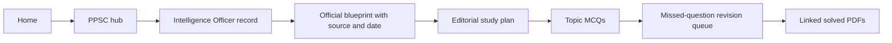
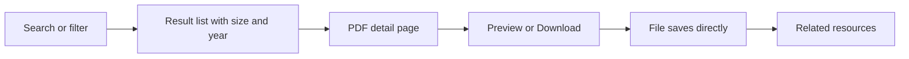
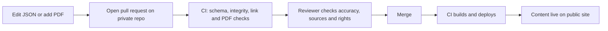
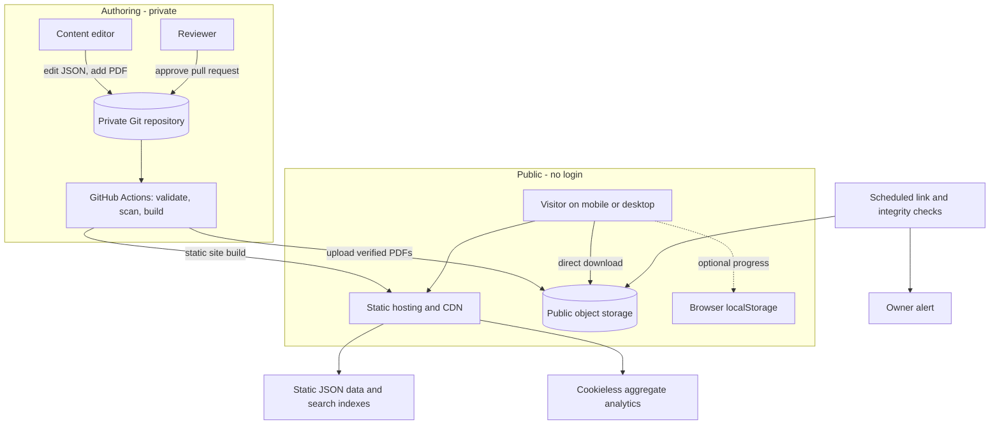
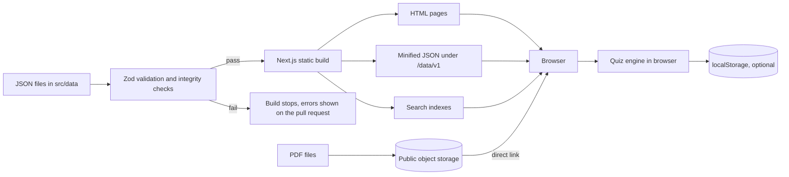
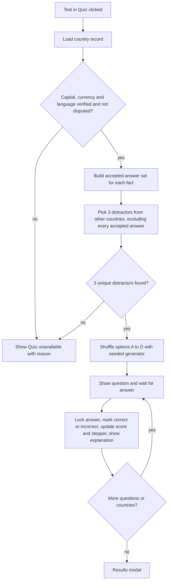
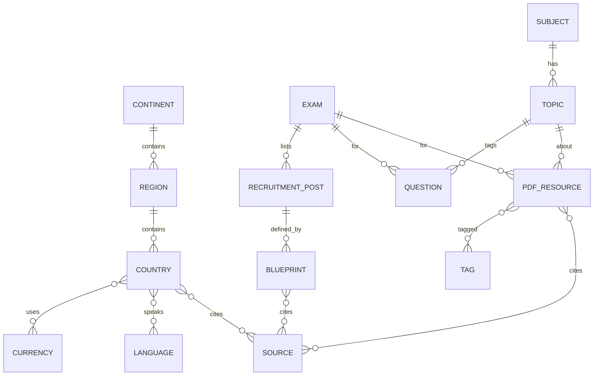

# docmubashirchaudhry — Product Requirements Document

**Version:** 2.0 (JSON-based, database-free architecture; supersedes 1.0) · **Date:** 10 November 2026 · **Status:** Master product specification

> **Revision 2.0 (10 November 2026).** The architecture is now JSON-based and database-free: version-controlled JSON files are the source of truth, the site is statically generated, quizzes run in the browser, and content is published through a reviewed Git workflow. The Geography module follows the two-tier system (Reference Guide and Interactive Quiz). See the Revision Record after Section 0 for what was removed, changed and retained.

## 0. Critical Findings Before Build (Read First)

Research on 10 Nov 2026 surfaced issues that change the scaffold. They are stated up front so nobody builds on a wrong premise.

| # | Finding | Impact | Decision |
| --- | --- | --- | --- |
| F1 | The scaffold names a flagship track “Intelligent Officer (Special Branch BS-16)”. The current PPSC advertisement found (Advertisement No. 11/2026, Serial 187, Case 10-RH/2026, published 9 Oct 2026, applications closed 26 Oct 2026) lists **Intelligence Officer, Special Branch, Punjab Police, BS-14**, 30 posts, on a two-year extendable contract. No BS-16 version was found. | The track name and scale may be wrong. Publishing “BS-16” could mislead aspirants. | **Do not hard-code “BS-16”.** Store post title and basic scale as data fields on each recruitment record. Launch the track as “Intelligence Officer, Special Branch (Punjab Police)” with the scale populated per advertisement. **Owner must confirm** whether a BS-16 post exists or the scaffold used the wrong scale. |
| F2 | Secondary sources agree the written test is **one MCQ paper, 100 marks, 90 minutes**, about **80% General Ability** (General Knowledge, Pakistan Studies, Current Affairs, Geography, Basic Mathematics, English, Urdu, Everyday Science, Islamic Studies / General Knowledge for non-Muslims) and about **20% Basic Computer Studies**. | The scaffold promises “subject-wise 100-mark allocation”. The sources found give only this two-part split with approximate shares. | **Do not publish a per-subject marks table as official.** Publish the official two-part split labelled “approximate, per advertisement”. Any per-subject breakdown is an editorial study recommendation, labelled as such. |
| F3 | The syllabus column in the advertisement is headed “if held”, so PPSC decides whether a written test is held. One source reports no more detailed syllabus was on PPSC’s Syllabus page on 18 Oct 2026. | Blueprints can be conditional and can change per advertisement. | Model blueprints **per advertisement/case number**, not per post title. Show an “if held” flag. |
| F4 | The figures above came from news and job-portal sites (ProPakistani, Pakera, Nexhirex, MOCC Prep, PKJobsBank). I could not open the official PPSC PDF directly. | These are not primary sources. | Before launch the content verifier must download the original advertisement from ppsc.gop.pk, attach the PDF as the source record, and record a verification date. Until then, status = **“Unverified (secondary source)”**. |

### Verification log (this document)

| Claim | Source type | Source | Checked | Status |
| --- | --- | --- | --- | --- |
| Ad 11/2026, Intelligence Officer BS-14, 30 posts, 2-year extendable contract, Punjab domicile | Secondary | propakistani.pk (9 Oct 2026); bloompakistan.com; pkjobsbank.com | 10 Nov 2026 | Unverified vs official PDF |
| Case 10-RH/2026, Serial 187; Open 23, Special 1, Minority 1, Women 5; age limit 40 (M) / 43 (F) | Secondary | pkjobsbank.com | 10 Nov 2026 | Unverified vs official PDF |
| 100 marks, 90 min, MCQ; \~80% General Ability, \~20% Basic Computer Studies | Secondary | propakistani.pk, nexhirex.com, pakera.pk | 10 Nov 2026 | Unverified vs official PDF |
| Syllabus applies “if held” | Secondary | moccprep.com, nexhirex.com | 10 Nov 2026 | Unverified vs official PDF |

PPSC here means the **Punjab** Public Service Commission (ppsc.gop.pk). The same acronym is used by an Indian commission; the platform must never mix them.

**Market statistics:** none are cited in this PRD. I found no credible, current figure for the number of Pakistani competitive-exam aspirants during research, so Section 2 describes the problem qualitatively and lists what must be measured. Treat any number you see elsewhere as unverified until sourced.

---

## Revision Record: v1.0 to v2.0

Version 2.0 replaces PostgreSQL, Prisma, the admin dashboard and the server API with version-controlled JSON files, a Git review workflow and a statically generated site. The public-access rules are unchanged: no ads, no paywalls, no signup, no login.

| Status | Area | Detail |
| --- | --- | --- |
| Removed | Database | PostgreSQL, ORM (Prisma), SQL schemas, entity relationship diagram, indexes, migrations, seed operations, connection pooling, read replicas, database backups and point-in-time recovery |
| Removed | Admin dashboard | All admin screens (A01-A21), admin authentication, TOTP, roles and sessions inside the app, admin CRUD endpoints, the audit-log table |
| Removed | Server API | The `/api/v1` application API, including `POST /corrections` and every `/admin` endpoint |
| Removed | Server-side analytics | The `download_events` table; per-resource counts now come from CDN aggregates |
| Removed | Expiring download links | Signed short-lived storage URLs; downloads use stable public URLs |
| Removed | Separate quiz pages | `/geography/quiz`, `/play` and `/results`; the quiz is now a module on the Geography page |
| Changed | Architecture | Dynamic Next.js app plus database becomes a static Next.js site reading JSON through a data-access layer |
| Changed | Geography engine | Study/Recall views replaced by the two-tier system: Tier 1 Reference Guide and Tier 2 Interactive Quiz (Section 3.2, US-07) |
| Changed | Quiz data | Questions are generated from country JSON in the browser; no 750-record question file |
| Changed | Content publishing | Admin upload and review screens replaced by a Git workflow with automated validation (Section 9.F) |
| Changed | PDFs | Metadata in `pdf-resources.json`; files in public object storage (recommended) behind a CDN |
| Changed | Search | PostgreSQL full-text search replaced by a build-time search index loaded in the browser |
| Changed | Corrections | Web form replaced by a pre-addressed email link; no server stores submissions |
| Changed | Data models | SQL tables replaced by JSON files, TypeScript types and Zod schemas (Section 8) |
| Changed | Plan, metrics, risks | 14 sprints (28 weeks) become 11 sprints (22 weeks); KPIs and risks rewritten (Sections 9, 10, G) |
| Retained | Product | Vision, open-access philosophy, exam hubs, PPSC track, findings F1-F4, official-versus-editorial separation |
| Retained | Users and stories | Personas, journeys J1 and J3, user stories US-01 to US-05, US-11 and US-12 (dependencies updated) |
| Retained | Quality | Design system (Emerald and Gold), WCAG 2.2 AA, SEO, copyright and takedown rules, content accuracy rules |
| Retained | Security principles | Public content unauthenticated; editing restricted; upload checks (moved into CI); secure headers |

**New owner decisions created by v2.0:** (1) confirm editors can work through the GitHub web editor or CSV tooling (A12); (2) confirm the PDF storage option (A11, A13); (3) decide whether "national" languages count as "official" in the quiz (A14).

---

## 1. Executive Summary

### 1.1 Vision and value proposition

docmubashirchaudhry is a free, mobile-first preparation portal for Pakistan’s competitive examinations: PPSC, CSS, PMS, FPSC and NTS. It brings three things together in one place: a verified library of solved MCQ booklets authored and curated by Doc Mubashir Chaudhry, a structured World Geography knowledge engine covering 250+ countries and territories, and exam-specific preparation hubs built around official advertisements and syllabi.

The promise is simple and enforceable: **no advertisements, no paywalls, no registration.** An aspirant on a mid-range phone and a slow connection should be able to find a booklet and download it in under three taps, practise MCQs, or drill capitals and currencies without ever creating an account.

What sets it apart is trust and friction. Most prep sites monetise attention with ads, gate downloads behind sign-ups, and mix official requirements with unsourced guesses. This platform separates **official** information (with source URL and verification date) from **editorial** study advice, and treats a wrong fact as a product defect with a correction process.

### 1.2 Business and educational objectives

| Type | Objective |
| --- | --- |
| Educational | Give every aspirant free access to organised, accurate preparation material. |
| Educational | Improve geography retention using retrieval practice instead of passive lists. |
| Trust | Every blueprint and geography record carries a source and verification date. |
| Operational | Let a small editorial team publish and correct content through a reviewed Git workflow, supported by tooling that keeps JSON edits safe for non-developers. |
| Sustainability | Run on low, predictable infrastructure cost (see Section 5.D). Funding model is an **open assumption** (A1 in Risks). |

### 1.3 Measurable product objectives (hard commitments)

- 250+ country and territory records published, each with a source and verification date.
- 500+ PDF booklets published, each with verification status “Verified” and an ownership/licence record.
- 0 ads, 0 paywalls, 0 mandatory login gates on public content (checked in every release).
- All five exam hubs live (PPSC, CSS, PMS, FPSC, NTS).
- Public pages meet WCAG 2.2 AA for core flows.

### 1.4 Target audience and expected reach

Primary: PPSC, CSS/PMS, and FPSC/NTS aspirants, mostly graduates and final-year students, many on Android phones with variable connectivity. Reach is **not forecast here** because no sourced baseline exists; the baseline collection plan is in Section 10.

### 1.5 Key launch milestones

| Milestone | Target (from kickoff) |
| --- | --- |
| M1 Foundation: Next.js, design system, JSON schemas, validation, homepage | Week 4 |
| M2 Exam hubs, PPSC track, MCQ banks, PDF library with direct downloads | Week 8 |
| M3 World Geography Reference Guide and country profiles | Week 12 |
| M4 Two-tier Geography quiz with results and local progress | Week 16 |
| M5 FPSC, CSS, PMS, NTS, SEO, accessibility, security review | Week 20 |
| M6 Public launch | Week 22 |

Content verification (500+ PDFs, 250+ countries) runs in parallel and gates launch; it is not included in these development weeks (Section 9.0).

### 1.6 Success criteria

Launch is successful when: all hard commitments in 1.3 are met; PDF download success is at or above 99% over 30 days; and no unresolved P0/P1 defects remain. Growth targets are recommendations, separated in Section 10.

### 1.7 Differentiation

| Differentiator | Why it matters to the user |
| --- | --- |
| Source and verification date on every official fact | Aspirants waste months on outdated syllabi; this lets them judge currency. |
| Official vs editorial labelling | Prevents guesses being mistaken for PPSC rules. |
| No ads, no sign-up | Faster, calmer study; works on shared phones. |
| One-tap PDF download with preview | Lowers the biggest friction in free prep sites. |
| Retrieval-practice geography | Active recall beats re-reading lists. |
| Lightweight, low-bandwidth pages | Real access for users outside major cities. |

---

## 2. Problem Statement

### 2.1 Market situation

Competitive exam preparation in Pakistan is served by a mix of coaching academies, YouTube channels, Facebook/Telegram groups, job-portal blogs and PDF-sharing sites. Job-portal blogs are, as F4 shows, the most visible place where syllabus and test-pattern information appears for a given advertisement. I did not find a credible published figure for the total number of aspirants or for market size, so none is claimed. **Validation task (V1):** obtain sourced figures, for example applicant counts published by the commissions or the Higher Education Commission, before using any number in marketing.

### 2.2 Pakistan-specific challenges (evidence-backed where possible)

| Challenge | Evidence / basis | Status |
| --- | --- | --- |
| Syllabi and patterns vary per advertisement and may be conditional (“if held”) | Observed in Ad 11/2026 (F3) and in the PPSC syllabus formats reviewed | Evidenced |
| Aspirants must infer official info from third-party blogs | Observed: the Ad 11/2026 test pattern surfaced mainly via news and job portals (F4) | Evidenced |
| Same acronym (PPSC) is shared with an Indian commission, causing mixed-up results | Observed in search results during research | Evidenced |
| Connectivity and device limits | Common assumption | **Needs validation (V2)** |
| Cost of paid prep | Common assumption | **Needs validation (V3)** |

### 2.3 Pain points (illustrative scenarios, fictional)

1. A candidate searches “PPSC Intelligence Officer syllabus” and finds five pages with slightly different breakdowns, none linking the original advertisement.
2. A student finds a useful MCQ PDF, but the site demands sign-up, shows pop-up ads, and the file link is dead.
3. A CSS aspirant memorises 200 capitals from a flat list and cannot recall them under test conditions.
4. An FPSC candidate cannot tell which solved booklet matches the current syllabus year.

### 2.4 Existing alternatives and limits

| Alternative | Strength | Limitation |
| --- | --- | --- |
| Coaching academies | Guidance | Cost, geography |
| YouTube/Telegram/Facebook groups | Free, active | Unorganised, unverifiable, files disappear |
| Job-portal blogs | Fast news | Secondary sources, ads, inconsistent detail |
| General quiz apps | Practice | Not exam-specific, often require accounts |

This comparison is qualitative and based on reviewing public pages; a structured competitor audit is task V4.

### 2.5 Opportunity and cost of inaction

Opportunity: a single trusted, free, verifiable library. Cost of inaction: aspirants keep losing time to scattered and sometimes wrong material, and Doc Mubashir Chaudhry’s booklets remain distributed through unstable channels. Quantifying this cost requires user research (V5).

---

## 3. Solution Overview

### 3.1 Platform structure

| Module | Role | Key interaction |
| --- | --- | --- |
| Homepage | Entry, search, top resources | Search box, exam tiles, latest PDFs |
| Exam directory | Lists PPSC, CSS, PMS, FPSC, NTS | Choose an exam |
| PPSC hub | Recruitment records, blueprints, cadre pages | Browse by advertisement/post |
| CSS/PMS hub | Subject guidance, geography links | Browse by subject |
| FPSC hub | Post-wise test pattern, MCQs | Browse by post/year |
| NTS hub | Test-type guidance, MCQs | Browse by test |
| World Geography engine | Two-tier system: Reference Guide and Interactive Quiz | Filter, Test in Quiz, answer, retake |
| MCQ practice | Subject and topic practice | Answer, feedback |
| PDF library | 500+ booklets | Filter, preview, download |
| Search | Global, typo-tolerant | One box across all content |
| Git content workflow | Content operations without a database | Edit JSON, open pull request, validate, review, deploy |

How they connect: every PDF, MCQ, topic and country links to a subject/topic, and each exam blueprint links to topics, so “related resources” is derived from shared topics and tags rather than manual curation.

### 3.2 World Geography engine

Version 2.0 implements the Geography module as a two-tier learning system on one page, `/geography`. Tier 1 is a Reference Guide at the top; Tier 2 is an Interactive Quiz module below it. All data comes from the country JSON files (Section 8).

**Tier 1: Reference Guide.** Controls at the top: alphabet filters A-Z, continent and region filters, country search, a clear-filters button and a country result count. Each country card shows four items: (1) country name and flag, (2) capital, (3) currency, (4) official language. Answers appear in the signature golden pills (background #FEF08A, text #78350F). Each card has a **Test in Quiz** button that selects that country, activates its quiz sequence, smoothly scrolls to the quiz module, shows the first question and updates quiz progress. A **Quiz this selection** button runs the sequence for every eligible country in the current filter.

**Tier 2: Interactive Quiz.** Each eligible country has exactly three sequential questions: capital, currency, official language. Each question has one correct and three unique incorrect options, shuffled into A, B, C, D; the answer locks after selection. A correct answer turns green with a check icon and adds one point. An incorrect answer turns red with a cross icon and reveals the correct option, with no point. After every answer the page shows an explanation, the live score and an updated progress stepper. When all selected countries are done, a results modal shows total questions, correct answers, incorrect answers, percentage, a retake option and a next alphabet or region option. A score of 70% or more triggers a celebration animation, replaced by a static badge when the visitor prefers reduced motion.

**Question generation.** No question records are stored. Functions in `src/lib/quiz` read the country JSON and build each question in the browser. Rules:

| Case | Behaviour |
| --- | --- |
| Several capitals, currencies or official languages | Wording asks for "a" valid answer (for example "Which of the following is an official language of X?"); one accepted answer is correct; all other accepted answers for that country are excluded from the incorrect options |
| Shared currencies | The correct answer may repeat across countries; distractors never equal any accepted answer for the selected country |
| Alternative spellings | Matched case- and diacritic-insensitively; a distractor matching any accepted spelling is rejected |
| Disputed or ambiguous facts | Shown in the Reference Guide with a neutral note and source; excluded from scored questions until reviewed |
| Missing or unverified facts | Guide shows "Not yet verified"; the quiz button shows "Quiz unavailable" with the reason |
| Too few distractors | If fewer than three unique valid incorrect options exist, the country is marked ineligible; the engine never invents an incorrect answer |

Distractors are real facts taken from other countries, preferring the same region, then the same continent, then the whole dataset, so options are plausible but never correct. Shuffling uses a seeded generator so a refresh restores the same option order.

**Explanations.** Built from templates plus the record's data: the answer, any other capitals or the currency code, the source and the last-verified date.

**Verification and updating.** Every country record carries sources, a verification status and a last-verification date. Only records with publication status "published" and verification status "verified" appear. Review intervals are in Additional Requirement C.

**Progress.** Browser-side only: React state plus optional localStorage (Section 8.8). No account, server or answer history exists. Answer keys are public by design; this is a practice tool, not a secure or proctored exam.

### 3.3 PPSC recruitment track (Intelligence Officer, Special Branch)

Per finding F1 this track is data-driven and not hard-coded to BS-16.

- **Recruitment record** (per advertisement and case): post title, department, basic scale, vacancies and quota split, qualification routes, age limits, domicile, contract terms, application dates, status (open/closed), source PDF, verification date.
- **Official blueprint** (per advertisement): paper type, total marks, duration, “if held” flag, and **only the official sections as published**. For Ad 11/2026 as reported: 100 marks, 90 minutes, MCQ, about 80% General Ability and about 20% Basic Computer Studies, with the named General Ability subjects listed **without invented per-subject marks**.
- **Editorial study plan** (clearly labelled “Platform recommendation, not official”): suggested topic weighting, subtopic tree, revision schedule. Rendered visually distinct from the official block.
- **Practice:** topic-wise MCQs, a revision queue of missed questions (stored locally), and linked solved PDFs.
- Applications for Ad 11/2026 closed on 26 Oct 2026; the page must show a “Closed” state and stay useful as a preparation page, and be ready to attach a new advertisement when one appears.

The platform must not state or imply affiliation with PPSC. Use a standing disclaimer.

### 3.4 PDF repository

- 500+ booklets, each described in `pdf-resources.json`: title, description, exam, subject, topic, year, author, file size, page count, public URL, publication and verification status, and a copyright and permission record. PDFs stay separate binary files and are never embedded in JSON.
- One-click download through a stable public URL: a plain link with no interstitial, login or expiring token. File size is shown before download.
- Storage: public object storage behind the CDN is recommended for 500+ files (Section 5.A); `public/pdfs` is acceptable only for an initial set of about 50 files or fewer.
- Preview: a first-page thumbnail generated in CI; the full file opens through the direct link.
- Search and filters run in the browser over the metadata (exam, subject, topic, year, type).
- Versioning: Git history for metadata; versioned file names (for example `-v2`) behind one stable resource slug; older files stay in storage.
- Broken-link monitoring: a scheduled CI job checks every published URL (status, content type, size, checksum) and alerts the owner.
- Download tracking: aggregate counts from CDN or analytics only; no per-user data.
- Verification workflow: pull-request review with a checklist plus automated checks (Section 9.F).

### 3.5 Open-access model

Every public page, data file and PDF is a static asset served without authentication. There are no student accounts, sessions or server-side quiz history. Abuse protection comes from the CDN (rate limiting and bot filtering that never put a CAPTCHA or login on reading paths). Content is protected at the source: only authorised editors can change the private Git repository, with MFA, branch protection and mandatory review. How hosting is funded without ads or paywalls remains an open assumption (A1).

### 3.6 Visual design system (summary; tokens in Section 5.B)

Academic Emerald and Gold, high contrast for bright daylight, system-friendly fonts with Urdu support, minimal animation. Answer highlighter pills (background #FEF08A, text #78350F) mark every answer shown in the Geography reference cards and answer reveals; MCQ states use colour **plus** icon and text so colour is never the only signal. Authority crests are used only with written permission or clear legal basis; otherwise use text names. Layouts are mobile-first with a single-column base, 44px minimum touch targets and WCAG 2.2 AA contrast.

## 4. User Personas

All personas are **fictional composites** for design purposes. Quotes are illustrative, not research findings. Persona validation through interviews is task V5.

### 4.1 Persona P1 — Ayesha Raza, PPSC aspirant

| Attribute | Detail |
| --- | --- |
| Age range | 24–28 |
| Education | BS Criminology, second division, public university in Punjab |
| Goal | Intelligence Officer, Special Branch (Punjab Police) and similar PPSC posts |
| Digital literacy | Medium; comfortable with WhatsApp, Chrome, PDFs |
| Device / connectivity | Android mid-range phone; mobile data, intermittent |
| Daily workflow | 2 hours before work: MCQs and revision; evening: 1 hour of weak subjects |
| Pain points | Conflicting syllabus info; no way to know what is official; ad-heavy sites |
| Expectations | Official-source links, dated info, topic-wise MCQs, printable booklets |
| Motivation | Secure a government post and family stability |
| Success outcome | Clears the written test; feels prepared on every listed subject |
| Quote (illustrative) | “I just want to know what PPSC actually announced, and practise on that.” |

### 4.2 Persona P2 — Hamza Qureshi, CSS/PMS aspirant

| Attribute | Detail |
| --- | --- |
| Age range | 25–30 |
| Education | MA International Relations |
| Goal | CSS, with PMS as backup |
| Digital literacy | High; uses Notion, flashcards |
| Device / connectivity | Laptop plus phone; home broadband |
| Daily workflow | Morning: essay and current affairs; evening: geography and general knowledge revision |
| Pain points | Flat country lists that do not support recall; unsure which facts are current |
| Expectations | Searchable country data, a Test in Quiz button on every country card, dated sources, quick filters by region |
| Motivation | Career in the civil service |
| Success outcome | Instant recall of capitals, currencies and languages |
| Quote (illustrative) | “Lists don’t help me. I need to be tested, not shown the answer.” |

### 4.3 Persona P3 — Bilal Ahmed, FPSC/NTS candidate

| Attribute | Detail |
| --- | --- |
| Age range | 22–27 |
| Education | BSc, recent graduate |
| Goal | FPSC/NTS posts across federal departments |
| Digital literacy | Low to medium; mostly phone |
| Device / connectivity | Low-end Android, prepaid data with limited allowance |
| Daily workflow | Searches for “solved MCQs PDF”, downloads to read offline |
| Pain points | Sign-up walls, dead links, large downloads without size info |
| Expectations | Clear file size, one-tap download, no login, works on weak signal |
| Motivation | Any federal job |
| Success outcome | Finds the right booklet and downloads in under a minute |
| Quote (illustrative) | “Show me the file size first. My data is limited.” |

### 4.4 Persona A1 — Content Editor (Doc Mubashir Chaudhry or delegate)

| Attribute | Detail |
| --- | --- |
| Age range | 30–50 |
| Education | Domain expert and educator |
| Goal | Publish and maintain accurate booklets and data through a reviewed Git workflow (GitHub web editor or CSV tooling), without writing code |
| Digital literacy | Medium to high |
| Device | Laptop; sometimes phone for quick checks |
| Daily workflow | Add the PDF to storage, edit JSON metadata, open a pull request, publish after review; respond to corrections |
| Pain points | Manual link tracking; fear of publishing errors; unclear rights on third-party material |
| Expectations | Clear templates, plain-language validation errors, review states on pull requests, Git history for audit and rollback |
| Motivation | Reach more students with trustworthy material |
| Success outcome | New booklet live after the next deployment (target under 15 minutes after merge) with correct metadata and verified status |
| Quote (illustrative) | “If I make a mistake, I need to fix it fast and show what changed.” |

### 4.5 User journeys

**J1 — PPSC aspirant (Intelligence Officer)**



Success: the user sees the source PDF link and verification date within two taps, and can start practice in one more.

**J2 — CSS/PMS aspirant (World Geography)**


**J3 — FPSC/NTS candidate (PDF download)**



**J4 — Content editor publishes a booklet (Git workflow)**



---

## 5. Technical Architecture

The platform is a statically generated Next.js site. JSON files in the private Git repository are the only source of truth for public educational content; there is no database, no ORM, no application server and no student authentication.

### 5.A Technology stack

Principle: one language (TypeScript), one framework, one source of truth (JSON in Git). Anything that needs a server is deferred.

| Layer | Choice | Purpose | Rationale |
| --- | --- | --- | --- |
| Frontend | Next.js (App Router), React, TypeScript, static generation (`output: 'export'`) | Pages and routing | Pre-rendered HTML is fast, SEO-friendly and cheap to host; client components only where interaction needs them (filters, search, quiz) |
| UI | Tailwind CSS plus a small in-house component library | Styling | Small CSS output; tokens map to Emerald and Gold |
| Content source | JSON files in `src/data` | Source of truth | Version-controlled, reviewable, no runtime dependency (Section 8) |
| Validation | TypeScript interfaces and Zod schemas | Data contracts | One schema validates in CI, at build time and in light runtime guards; types derive from schemas |
| Data access | `src/lib/data` repository layer | Only code allowed to read JSON | Pages depend on an interface, so JSON can later be replaced by a database or CMS without rewriting pages |
| Quiz logic | Pure TypeScript modules in `src/lib/quiz` | Question generation, scoring | Runs in the browser; unit-testable without a server |
| State | React state with `useReducer`; optional lightweight store (Zustand); localStorage | Quiz and MCQ progress | No server state exists; progress is optional and device-specific |
| Search | MiniSearch (or Fuse.js) with indexes built at build time and lazy-loaded | Global and library search | Works offline once loaded; no search server |
| PDF storage | Public S3-compatible object storage (for example Cloudflare R2) behind a CDN custom domain; `public/pdfs` only for about 50 files or fewer | Binary PDFs | See storage recommendation below |
| Hosting and CDN | Cloudflare Pages plus Cloudflare CDN (Netlify or Vercel static hosting are alternatives) | Serve static site | Static hosting scales through the CDN; confirm limits and pricing in task V6 |
| Analytics | Cookieless aggregate analytics (Plausible or Cloudflare Web Analytics) | Traffic and aggregate events | No cookies, no student profiles |
| Monitoring | Uptime monitor; scheduled GitHub Actions checks; optional client error reporting without personal data | Reliability | Detects downtime and broken downloads |
| Testing | Vitest, Playwright, axe, Lighthouse CI, data-validation suite | Quality gates | Runs on every pull request |
| CI/CD | GitHub Actions on a private repository | Validate, build, deploy | Preview deployment per pull request |
| Authentication | None in the product | - | Editors authenticate to GitHub (MFA required); this is outside the app |

**Not used in version 1:** PostgreSQL or any database, Prisma or any ORM, database migrations, student accounts, server-side quiz storage, a website admin dashboard, GraphQL, microservices, Kubernetes, a headless CMS.

**PDF storage recommendation.** For 500+ booklets, use public object storage behind the CDN. Assumption A11: an average of 3 MB per booklet gives about 1.5 GB in total. That volume would bloat the Git repository, slow every build and may exceed per-file or per-deployment limits of static hosts (to confirm in V6). Storage keeps files out of Git and out of each deploy, serves them directly from the CDN, and keeps bandwidth predictable. The metadata, stable public URL, SHA-256 checksum and file size stay in `pdf-resources.json`, and a CI script uploads the file and writes those values so they cannot drift. Starting with `public/pdfs` is acceptable only for a small first release (about 50 files or under 100 MB), with a migration to storage by changing the URL field only.

### 5.B Frontend architecture

**Application structure**

```
src/
  app/                public routes only (see Additional Requirement A)
  components/         ui/, layout/, geography/ (CountryCard, AlphabetBar, FilterBar,
                      QuizPanel, ProgressStepper, ResultsModal), mcq/, library/, exams/
  lib/
    data/             repository layer: the only code that reads JSON
    schemas/          Zod schemas and inferred TypeScript types
    quiz/             question generators, option builder, scoring, explanations, seeded PRNG
    storage/          versioned localStorage wrapper with in-memory fallback
    search/           index loading and client search
  data/               JSON content (Section 8)
public/               flags/, thumbnails/, static assets (pdfs/ only for a small set)
scripts/              validate, build-search-index, pdf-manifest, import-csv, export-csv, check-links
```

**Routes** are listed in Additional Requirement A.

**Design tokens (proposed; contrast values to be tested)**

| Token | Value | Use |
| --- | --- | --- |
| `--emerald-900` | #064E3B | Headers, primary text on light |
| `--emerald-700` | #047857 | Primary buttons, links |
| `--emerald-50` | #ECFDF5 | Page tint |
| `--gold-500` | #B8860B | Accents |
| `--pill-bg` | #FEF08A | Golden answer pill background (fixed by product decision) |
| `--pill-text` | #78350F | Golden answer pill text (fixed by product decision) |
| `--ink` | #111827 | Body text |
| `--surface` | #FFFFFF | Cards |
| `--correct` | #166534 with check icon | Correct answer |
| `--incorrect` | #B91C1C with cross icon | Incorrect answer |

The pill pair calculates to roughly 7.8:1 contrast; the design phase verifies this and every other pair at 4.5:1 or better (3:1 for large text and UI components).

**Typography:** system sans stack for Latin; Noto Nastaliq Urdu or Noto Naskh Arabic loaded only on pages with Urdu text; base size 18 px on mobile; line height 1.6.

**Responsive behaviour:** mobile-first single column; two columns at 768 px; three-column grids at 1024 px; tables become stacked cards on narrow screens.

**State management:** build-time data for pages; URL query parameters for filters; a `useReducer` quiz store; versioned localStorage for optional progress (Section 8.8). If localStorage is unavailable the quiz keeps working in memory for the session.

**Forms and validation:** the site has no submission forms. Search and filter inputs are validated with Zod against URL parameters; invalid values fall back to defaults.

**Data integration:** pages read data at build time through the repository layer. Interactive modules fetch read-only JSON from `/data/v1/` on demand and cache it in memory (Section 7).

**SEO:** pre-rendered pages, per-page title and description, canonical URLs, sitemap, JSON-LD (`Dataset`, `CreativeWork`, `BreadcrumbList`), and a visible last-verified date on official pages.

**Error, empty and loading states:** skeleton placeholders; friendly empty states with a next action; a retry button when a JSON file fails to load; a static offline message.

### 5.C Data access and logic architecture (replaces the backend)

There is no application server. Logic lives in typed modules that run at build time, in CI or in the browser.

| Module | Runs | Responsibility |
| --- | --- | --- |
| `lib/data` (repository) | Build and browser | Typed read functions over JSON; filtering and lookup; single swap point for a future database |
| `lib/schemas` | Everywhere | Zod schemas and TypeScript types for every JSON file |
| `scripts/validate` | CI and local | Schema checks and cross-file integrity rules (Section 8.6) |
| `lib/geography` | Browser | Alphabet index, region and continent filters, quiz eligibility |
| `lib/quiz` | Browser | Question generation, distractor selection, shuffling, scoring, explanations |
| `lib/questions` | Browser | MCQ selection by exam, subject and topic; answer feedback |
| `lib/library` | Browser | PDF filtering, sorting and related-resource lookup |
| `lib/search` and `scripts/build-search-index` | Build and browser | Index generation and client search |
| `scripts/pdf-manifest` | CI | Checksum, size, page count, thumbnail, upload, metadata write-back |
| `scripts/check-links` | Scheduled CI | HEAD and checksum checks of every published PDF |
| `scripts/import-csv` and `export-csv` | Local and CI | Spreadsheet-to-JSON conversion for non-technical editors |

**Repository roles (GitHub, not the app):** Owner (repository admin), Editor (opens pull requests), Reviewer (required approver through CODEOWNERS), Reader. No role exists in the public product.

### 5.D Infrastructure

| Area | Specification |
| --- | --- |
| Site hosting | Static hosting with global CDN; production and preview environments |
| File storage | Public object-storage bucket on a custom domain behind the CDN; object versioning enabled; second backup bucket or periodic mirror |
| Environments | `local`; `preview` (one per pull request); `production` |
| Configuration | Build-time environment variables in the CI secret store; no secrets in the client bundle; storage upload token held only in CI with write scope limited to the PDF bucket |
| Backups | The Git repository is the content backup: mirror it to a second remote on a schedule and keep repository exports; PDF bucket versioning plus mirror; quarterly restore drill |
| Monitoring | External uptime check on key pages; scheduled link and checksum job; alerts to the owner |
| Logging | CDN and hosting logs only; no personal data stored by the application; 30-day retention |
| Deployment | Pull request, CI validation, preview, review, merge to main, automatic production build and deploy |
| Disaster recovery | RPO: last merged commit. RTO: 2 hours to rebuild from Git and redeploy (target; verified in the restore drill). PDF recovery from versioned storage or the mirror |

### 5.E Security

| Control | Specification |
| --- | --- |
| Public access | All pages, data files and PDFs are unauthenticated static assets |
| Authentication | None in the product. Content editing is restricted at the repository |
| Repository access | Organization with MFA required, branch protection on main, required reviews, CODEOWNERS for data folders, no force pushes, least-privilege access |
| Input validation | Zod schemas in CI and at build; the build fails on any invalid record; URL parameters validated in the browser |
| PDF ingestion checks | In CI: PDF magic bytes, maximum size, malware scan (for example ClamAV), reject encrypted files, embedded JavaScript and attachments, strip metadata, record SHA-256 |
| Rate limiting | CDN rules; downloads limited per IP without a login or CAPTCHA on reading paths |
| CSRF | Not applicable: no cookies, sessions or state-changing endpoints |
| XSS | React escaping; explanations stored as plain text or restricted markdown sanitised at build; strict Content Security Policy |
| SQL injection | Not applicable: no database |
| Secure headers | CSP, HSTS, `X-Content-Type-Options: nosniff`, `Referrer-Policy`, `Permissions-Policy`; PDFs served with `Content-Disposition: attachment` and the correct file name |
| Secrets | CI secret store only; rotation every 90 days |
| Audit trail | Git history and pull-request reviews |
| Supply chain | Lockfile, dependency audit in CI, pinned CI actions, automated update pull requests |
| Public answer keys | Accepted by design; the quiz is a practice tool, not a secure or proctored exam |

### 5.F Performance and scalability targets

Targets for a mid-range Android phone on a throttled 4G profile, measured with Lighthouse CI and field data.

| Metric | Target |
| --- | --- |
| First-load JavaScript per page | 150 KB gzip or less; the quiz module is loaded on demand |
| LCP (p75) | 2.5 s or less |
| INP (p75) | 200 ms or less |
| CLS | 0.1 or less |
| Time to first byte (CDN cached) | 300 ms or less |
| Countries dataset (published) | About 150 KB gzip or less (estimate, to be measured) |
| Question-bank file | 200 KB gzip or less each; split by exam and subject |
| Search index | 150 KB gzip or less per content type, lazy-loaded |
| Question generation | 50 ms or less per question on a mid-range phone |
| PDF download start (p95) | 2 s or less from the CDN edge |
| Lighthouse (mobile) | Performance 90 or more, Accessibility 95 or more |
| Low bandwidth | Core pages usable at 150 KB/s; images lazy-loaded; no autoplay media |

**Scaling path.** Traffic scales through the CDN because every response is static. Content growth is handled by splitting JSON by exam and subject and lazy-loading. Triggers to consider a database or CMS (version 2): more than about 20,000 questions, builds longer than 10 minutes, or an editorial team too large for pull requests to be practical.

### 5.G Architecture diagram



### 5.H Data-flow diagrams

**Build and delivery**



**Quiz generation**



---

## 6. Functional Requirements

Scope tags: **MVP** = launch-blocking; **Later** = after launch. Priorities: P0 must-have, P1 important, P2 nice-to-have.

### 6.1 User stories

#### US-01 Homepage and navigation (P0, MVP)

- **Story:** As an aspirant, I want a clear homepage so that I can reach my exam or a resource in one tap.
- **Description:** Search box, five exam tiles, latest PDFs, geography entry, open-access statement, standing non-affiliation notice.
- **Preconditions:** None.
- **Acceptance criteria:** (1) Page renders with no login prompt, ad slot or cookie wall. (2) Header has links to Exams, Geography, MCQs, Library, Search. (3) Each exam tile links to its hub. (4) Menu is reachable by keyboard and has a visible focus state. (5) LCP ≤ 2.5 s on the reference mobile profile.
- **Expected behaviour:** Mobile uses a bottom or collapsible menu; desktop uses a top bar.
- **Error states:** If “latest PDFs” fails, show the section with a retry link; rest of page unaffected.
- **Dependencies:** US-02, US-09, US-11.

#### US-02 Examination category browsing (P0, MVP)

- **Story:** As an aspirant, I want to browse exams so that I can find material for my test.
- **Acceptance criteria:** (1) `/exams` lists PPSC, CSS, PMS, FPSC, NTS. (2) Each hub shows exam description, official-source link, last-verified date and links to MCQs and PDFs. (3) Exam hubs with no content show an empty state naming what is coming, never a blank page. (4) Page title includes the exam name.
- **Error states:** Unknown exam slug returns a 404 page with links to the exam list.
- **Dependencies:** exams.json and sources.json, US-12.

#### US-03 PPSC Intelligence Officer preparation (P0, MVP)

- **Story:** As a PPSC aspirant, I want one page for the Intelligence Officer post so that I see requirements and practice together.
- **Description:** Recruitment record (post, department, scale as published, vacancies, qualification routes, age, domicile, dates, status), blueprint (US-04), editorial plan, MCQs, linked PDFs.
- **Preconditions:** A verified recruitment record exists.
- **Acceptance criteria:** (1) Basic scale is rendered from data, not hard-coded text. (2) A closed advertisement shows a “Closed on \<date>” badge. (3) Official and editorial blocks are visually distinct and labelled. (4) A source link and verification date are visible without scrolling past the first screen on a 360 px wide viewport.
- **Error states:** If verification is older than the review interval, show an “Outdated, check source” banner.
- **Dependencies:** US-04, US-08, US-10, Finding F1.

#### US-04 Examination blueprint presentation (P0, MVP)

- **Story:** As an aspirant, I want to see the official test pattern so that I study what is actually tested.
- **Acceptance criteria:** (1) Blueprint shows paper type, total marks, duration, “if held” flag, and sections exactly as published. (2) No per-subject mark appears in the official block unless a source document states it. (3) Each blueprint has a source URL, source PDF copy, verification date and version. (4) Older versions are viewable via a version selector. (5) The editorial recommendation block always carries the label “Platform recommendation, not official.”
- **Error states:** Missing source blocks publication in the CI validation step (US-15).
- **Dependencies:** `blueprints.json`, `topics.json`, `sources.json`.

#### US-05 World Geography directory (P0, MVP)

- **Story:** As an aspirant, I want to search and filter countries so that I can find any entity quickly.
- **Acceptance criteria:** (1) `/geography` lists 250+ entities, paginated at 50 with stable URLs. (2) Search matches common name, official name and alternate names, tolerating one-character typos. (3) Filters: continent, region, currency, language, status; filters combine with AND and are reflected in the URL. (4) Result count is shown. (5) Zero results shows “No matches” with a clear-filters button.
- **Dependencies:** Geography JSON files, US-11.

#### US-06 Country detail (P0, MVP)

- **Story:** As an aspirant, I want a country page so that I see capital, currency and language at a glance.
- **Acceptance criteria:** (1) The page shows name, flag, ISO codes where available, capital(s), all currencies with ISO 4217 codes, languages with role, continent, region and entity type. (2) Disputed or changing facts display a visible note and source. (3) Sources and the "last verified" date are shown. (4) "Report a correction" opens a pre-addressed email (mailto) containing the country ID and page URL; nothing is submitted to a server. (5) An unknown slug shows the 404 page. (6) A "Test in Quiz" link returns to `/geography` with that country selected.
- **Dependencies:** US-05, US-15, `countries.json`.

#### US-07 Geography two-tier learning system (P0, MVP)

- **Story:** As an aspirant, I want a reference guide and a quiz on one page so that I study a country and test myself immediately.
- **Description:** Tier 1 Reference Guide on top; Tier 2 Interactive Quiz module below (Section 3.2).
- **Preconditions:** Published, verified country records exist.
- **Acceptance criteria (Tier 1):** (1) A-Z alphabet filters, continent and region filters, country search, a clear-filters button and a country result count are shown at the top of `/geography`. (2) Filters combine with AND and are reflected in the URL. (3) Each card shows name and flag, capital, currency and official language. (4) Answers are shown in golden pills (background #FEF08A, text #78350F; contrast at least 4.5:1). (5) Each card has a Test in Quiz button; clicking it selects the country, activates its sequence, smoothly scrolls to the quiz module (instantly when reduced motion is preferred), shows the first question and updates progress. (6) A Quiz this selection button runs the sequence for all eligible countries in the current filter.
- **Acceptance criteria (Tier 2):** (7) Each eligible country has exactly three sequential questions in this order: capital, currency, official language. (8) Each question shows one correct and three unique incorrect options, shuffled as A, B, C, D, with no duplicates (case- and diacritic-insensitive). (9) Selecting an option locks the question. (10) Correct: green background, check icon, one point added. Incorrect: red background, cross icon, correct option revealed, no point. (11) After every answer an explanation, the live score and the progress stepper are updated. (12) When all selected countries are complete a results modal shows total questions, correct, incorrect, percentage, Retake and Next alphabet or region. (13) At 70% or more a celebration animation plays; with reduced motion a static badge is shown instead.
- **Generation rules:** (14) Questions are generated from the country JSON; no stored question records. (15) Multiple capitals, currencies or languages use "which of the following is a valid answer" wording and exclude every other accepted answer from the incorrect options. (16) Disputed, missing or unverified facts make the country ineligible for scoring; the card shows the reason. (17) If fewer than three unique valid incorrect options exist the country is ineligible; no incorrect answer is ever invented.
- **Progress:** (18) State is kept in the browser; localStorage persists it when available; the quiz still works in memory when it is not; a Clear my progress control exists.
- **Error states:** Country data fails to load: retry message; no eligible countries in the current filter: message with a clear-filters button.
- **Dependencies:** `countries.json`, reference JSON, `question-rules.json`, US-05.

#### US-08 MCQ practice and feedback (P0, MVP)

- **Story:** As an aspirant, I want to practise MCQs with instant feedback so that I learn from mistakes.
- **Acceptance criteria:** (1) Filter by exam, subject and topic from the question-bank JSON files. (2) Selecting an option locks the answer and shows correct or incorrect (icon, text and colour), the correct option in a golden pill and the explanation. (3) A session summary shows score and missed questions. (4) Only questions that are published and verified appear. (5) Optional progress is saved only in localStorage; everything works without it.
- **Error states:** A set with fewer questions than requested shows the available count; a bank file that fails to load shows a retry message.
- **Dependencies:** question-bank JSON files, taxonomy JSON.

#### US-09 PDF search and filtering (P0, MVP)

- **Story:** As a candidate, I want to filter the library so that I find the right booklet.
- **Acceptance criteria:** (1) Filters: exam, subject, topic, year, type; sort by newest or title. (2) Each result shows title, subject, exam, year, page count, file size and verification badge. (3) The list updates within 200 ms of input on the reference phone because filtering runs in the browser. (4) Filters are reflected in the URL. (5) The empty state offers to clear filters and links to search.
- **Dependencies:** `pdf-resources.json`, search index, US-11.

#### US-10 One-click PDF download (P0, MVP)

- **Story:** As a candidate, I want to download in one tap with no gate.
- **Acceptance criteria:** (1) The download button on result cards and detail pages is a plain link to the stable public URL. (2) The download starts within 2 s (p95) from the CDN with no login, interstitial, advertisement or expiring token. (3) The response carries `Content-Disposition: attachment` and the file name from the metadata. (4) File size is shown before download. (5) Only resources that are published and verified are linked. (6) Counts come from CDN or analytics aggregates only.
- **Error states:** If a file is unavailable the detail page shows "temporarily unavailable" with a report-by-email link, and the scheduled checker alerts the owner. Archived resources keep their page with an archived notice and a replacement link where one exists (static hosting has no 410 response).
- **Dependencies:** public object storage, US-13.

#### US-11 Global search (P0, MVP)

- **Story:** As any user, I want one search box across all content.
- **Acceptance criteria:** (1) Searches PDFs, countries, exams, recruitment records, topics. (2) Results grouped by type with counts. (3) Typo tolerance of one edit for terms over 4 characters. (4) Query under 2 characters is rejected with a message. (5) Handles Urdu and English input.
- **Error states:** Search outage shows a fallback link to browse pages.

#### US-12 Related resources (P1, MVP)

- **Story:** As a learner, I want related items so that I continue studying without searching again.
- **Acceptance criteria:** (1) PDF, MCQ topic and country pages show up to 6 related items chosen by shared topic/tag/exam. (2) Related items never include unpublished or archived content. (3) Section is hidden if there are none.

#### US-13 Content publication through Git, replacing admin PDF upload (P0, MVP)

- **Story:** As a content editor, I want to publish a booklet through a reviewed pull request so that only checked files go live.
- **Description:** Edit JSON, add the PDF, open a pull request, pass automated checks, get review, merge, deploy (Section 9.F).
- **Acceptance criteria:** (1) The pull request contains the PDF and its record in `pdf-resources.json`. (2) CI runs the schema check, unique ID and slug check, file-exists check, size and checksum match, PDF safety checks (type, malware, encryption, JavaScript) and thumbnail generation. (3) Required fields: title, exam, subject, author, copyright holder, rights basis, source. (4) Merge is blocked until CI passes and a reviewer other than the author approves. (5) Merge triggers build and deploy; the content is public within 15 minutes (target). (6) The Git commit is the audit record.
- **Error states:** A CI failure blocks merge and lists each error with file, record ID and field; a failed malware scan blocks the file.
- **Dependencies:** Sections 5.E and 9.F.

#### US-14 Automated content validation, replacing admin geography and MCQ management (P0, MVP)

- **Story:** As an editor, I want automatic checks so that bad data never reaches the site.
- **Acceptance criteria:** (1) The build fails on duplicate IDs, invalid references (country, region, continent, topic, source IDs), missing required fields, invalid country identifiers, questions without the required answer options, a correct-option ID that is not among the options, missing PDF paths, duplicate or broken resource slugs, published facts that are not verified, and missing sources. (2) Every error names the file, record ID and field. (3) A CSV import validates every row and reports errors by row without writing partial data. (4) Validation runs locally with one command and on every pull request.
- **Dependencies:** `lib/schemas`, `scripts/validate`, Section 8.6.

#### US-15 Verification and version management through Git (P0, MVP)

- **Story:** As a reviewer, I want a verification workflow so that only checked content goes live.
- **Acceptance criteria:** (1) Each record carries a verification status, verified-by, verification date and source IDs. (2) A blueprint cannot be published without a source URL and verification date (CI rule). (3) Version history is Git history; rollback is a revert commit. (4) The pull-request template has a checklist: source checked, answer key checked, rights confirmed, official versus editorial label correct. (5) Public corrections arrive by email; target first response 3 working days, fix or reasoned rejection within 10 (A6). (6) A CI report lists records past their review interval.

### 6.2 Core user flows, behaviour and rules

| Topic | Requirement |
| --- | --- |
| Core flows | The four journeys in Section 4.5 plus: correction request, search-to-download, quiz restart |
| Navigation | Persistent header; breadcrumbs on all nested pages; back button preserves filters via URL state |
| Empty states | Always state what is missing and offer one next action |
| Loading states | Skeletons for lists; text indicator for data loading |
| Error states | Plain language, retry where possible, no stack traces; a 404 page and a generic error and offline state designed (static hosting) |
| Mobile | 360 px minimum width; 44 px touch targets; sticky download button on PDF pages; no horizontal scroll |
| Accessibility | WCAG 2.2 AA: keyboard operable, visible focus, labelled controls, alt text, ARIA live region for quiz feedback, reduced-motion respected, zoom to 200% without loss |
| Publication rules | Only Verified content is public; official blueprints require source + date; third-party material requires a recorded licence or permission; archived content is excluded from search and listings and its URL shows an archived notice |

### 6.3 MVP vs later

| MVP | Later (after launch) |
| --- | --- |
| US-01 to US-15; exam hubs; PPSC track; MCQ banks; PDF library with direct downloads; Geography two-tier system; global search; Git workflow with automated validation; scheduled link checks; aggregate analytics | Version 2 CMS or database (optional); richer analytics; PWA offline mode; Urdu interface; printable study sheets; spaced repetition; export and import of local progress; advertisement-alert emails (needs a privacy review); more exam categories |

**Do not build initially:** student accounts, signup or login, student profiles, any database or ORM, server-side quiz or attempt storage, a website admin or CRUD dashboard, comments or forums, leaderboards, payments, advertisement slots, social login, native apps.

---

## 7. Data Access and Interface Specifications (replaces the API)

Version 1 has no application API. Pages read JSON at build time through a repository layer, interactive modules fetch read-only static JSON files, and PDFs are direct public files. There is no POST, PATCH or DELETE endpoint for public content and no protected endpoint inside the product.

### 7.1 Conventions

| Topic | Rule |
| --- | --- |
| Content API | None. Build-time reads through the repository layer (7.2) |
| Public data files | Read-only static JSON under `/data/v1/`, GET and HEAD only |
| Write endpoints | None. Content changes go through Git (Section 9.F) |
| Public versus protected | Everything the product serves is public. Protection applies to the Git repository, not to endpoints |
| Authentication and roles | None in the product. Repository roles are in Section 5.C |
| Rate limiting | CDN rules: downloads 30 per minute per IP; data files 120 per minute per IP; no CAPTCHA or login on reading paths |
| Pagination | Listing pages are statically paginated for crawlers (`/library/page/2`); in-page lists paginate in the browser (`page`, `pageSize` UI state, default 20, maximum 100) |
| Filtering and sorting | Client-side over loaded JSON; parameters live in the page URL and are validated with Zod (`exam`, `subject`, `topic`, `year`, `type`, `continent`, `region`, `letter`, `q`, `sort`) |
| Versioning | Path prefix `/data/v1/` plus an integer `schemaVersion` in every file. A breaking change creates `/data/v2/`; the old path stays for 6 months |
| Validation | Zod at build and in CI; a light shape check on fetched JSON in the browser, with a retry state on failure |
| Error handling | Static 404 page; a failed JSON fetch shows an inline retry message; CDN errors show the host error page |
| Caching | Content-hashed file names for immutable assets; `Cache-Control: public, max-age=300, stale-while-revalidate=86400` for stable data paths |
| Upload and download security | No uploads through the site. PDF ingestion happens in CI (Section 5.E). Downloads are direct public files with `X-Content-Type-Options: nosniff` and `Content-Disposition: attachment` |

### 7.2 Repository layer (data-access contract)

Pages and components import only this interface. The JSON implementation ships in version 1; a database or CMS implementation can replace it later without touching pages.

```ts
export interface ContentRepository {
  getExams(): Promise<Exam[]>;
  getExam(slug: string): Promise<Exam | null>;
  getRecruitmentPosts(examSlug: string, status?: 'open' | 'closed' | 'upcoming'): Promise<RecruitmentPost[]>;
  getRecruitmentPost(slug: string): Promise<RecruitmentPost | null>;
  getBlueprint(postSlug: string, version?: number): Promise<Blueprint | null>;
  getCountries(filter?: CountryFilter): Promise<Country[]>;
  getCountry(slug: string): Promise<Country | null>;
  getGeographyReference(): Promise<{ continents: Continent[]; regions: Region[]; currencies: Currency[]; languages: Language[] }>;
  getQuestions(filter: QuestionFilter): Promise<Question[]>;
  getPdfResources(filter?: PdfFilter): Promise<PdfResource[]>;
  getPdfResource(slug: string): Promise<PdfResource | null>;
  getRelated(entity: { type: string; id: string }): Promise<RelatedItem[]>;
  getSources(ids: string[]): Promise<Source[]>;
  search(query: string, types?: string[]): Promise<SearchHit[]>;
}
```

Rules: every method returns only records with `publicationStatus = published` and `verification.status = verified` (except where a page explicitly shows an "unverified" label, such as the Intelligence Officer blueprint until its official PDF is checked); methods never mutate data.

### 7.3 Static read-only data files

| Method and path | Content | Size budget (gzip) | Used by |
| --- | --- | --- | --- |
| GET `/data/v1/manifest.json` | Content version, build time, record counts, SHA-256 per file | 5 KB | Integrity checks, "last updated" note |
| GET `/data/v1/geography/countries.json` | Published country records | 150 KB | Geography page, country pages, quiz |
| GET `/data/v1/geography/reference.json` | Continents, regions, currencies, languages | 20 KB | Filters, quiz distractors |
| GET `/data/v1/geography/question-rules.json` | Quiz rules and templates | 5 KB | Quiz engine |
| GET `/data/v1/examinations/exams.json` | Exam categories | 20 KB | Exam hubs, navigation |
| GET `/data/v1/examinations/ppsc/recruitment-posts.json` | PPSC recruitment records | 40 KB | PPSC hub |
| GET `/data/v1/examinations/ppsc/blueprints.json` | Official and editorial blueprints | 40 KB | Blueprint views |
| GET `/data/v1/questions/{exam}/{bank}.json` | One MCQ bank | 200 KB | MCQ practice |
| GET `/data/v1/resources/pdf-resources.json` | PDF metadata | 150 KB | Library, detail pages |
| GET `/data/v1/search/{type}.json` | Search index per content type | 150 KB | Search |
| GET `https://<files-domain>/pdfs/{exam}/{file}.pdf` | The PDF binary | - | Direct downloads |

**Example: `/data/v1/manifest.json`**

```json
{
  "schemaVersion": 1,
  "contentVersion": "2026.11.11-1",
  "builtAt": "2026-11-11T09:30:00Z",
  "counts": { "countries": 250, "pdfResources": 500, "questions": 1200 },
  "files": [
    { "path": "geography/countries.json", "sha256": "<64-hex-characters>", "bytes": 412000 }
  ]
}
```

(Counts are placeholders, not current data.)

HTTP behaviour: `200` with the file; `304` on a conditional request; `404` for an unknown path. There is no `401`, `403`, `409`, `422` or `5xx` application error because nothing validates input on a server.

### 7.4 Endpoints removed from version 1.0

| Removed endpoint group | Replacement |
| --- | --- |
| `GET /api/v1/exams`, `/exams/{slug}`, `/recruitments`, `/blueprint` | `getExams`, `getExam`, `getRecruitmentPosts`, `getBlueprint` plus static JSON |
| `GET /api/v1/geography/countries`, `/countries/{slug}` | `getCountries`, `getCountry` plus `countries.json` |
| `GET /api/v1/geography/quiz` | Browser quiz engine reading `countries.json` and `question-rules.json` |
| `GET /api/v1/mcqs` | `getQuestions` plus question-bank JSON |
| `GET /api/v1/library/resources` and `/{slug}`; `GET /download/{slug}` | `getPdfResources`, `getPdfResource`; direct public PDF URL |
| `GET /api/v1/search` | Client search over build-time indexes |
| `POST /api/v1/corrections` | A pre-addressed email link containing the record ID and page URL |
| All `/api/v1/admin/*` endpoints | Git pull requests, CI validation and the review workflow |

---

## 8. JSON Data Models

JSON files in Git are the source of truth for all public educational content. There are no tables, relationships, indexes, migrations or seed operations. Records reference each other by stable string IDs, and the validator (Section 8.6) enforces those references.

### 8.1 Conventions

| Topic | Rule |
| --- | --- |
| File shape | `{ "schemaVersion": 1, "updatedOn": "YYYY-MM-DD", "records": [ ... ] }` |
| IDs | Stable lowercase kebab-case strings; unique within a file; never reused after archiving |
| Field names | camelCase |
| Dates | ISO 8601 (`YYYY-MM-DD`); verification dates are required on published records |
| Statuses | `publicationStatus`: draft, published, archived. `verification.status`: unverified, in\_review, verified |
| Sources | Every published fact or document points to one or more IDs in `sources.json` |
| Binary files | PDFs and images are never embedded in JSON; JSON stores a path or URL |
| Encoding | UTF-8; no personal data of any visitor |
| Size | Split files by exam and subject; keep each served file within the budgets in Section 7.3 |

### 8.2 Final folder structure

This keeps the proposed layout and adds `sources.json`, flags, thumbnails, scripts and workflows. PDFs follow the same `pdfs/{exam}/` layout, but their primary home is public object storage; `public/pdfs` is used only for a small first release.

```
src/
  data/
    sources.json
    geography/
      countries.json  continents.json  regions.json  currencies.json  languages.json
    examinations/
      exams.json
      ppsc/   recruitment-posts.json  blueprints.json  topics.json
      fpsc/   exams.json  topics.json
      css/    subjects.json
      pms/    subjects.json
      nts/    test-categories.json
    questions/
      geography/  question-rules.json
      ppsc/   general-knowledge.json  pakistan-studies.json  current-affairs.json  intelligence-officer.json
      fpsc/   questions.json
      css/    questions.json
      pms/    questions.json
      nts/    questions.json
    resources/  pdf-resources.json
    taxonomy/   subjects.json  topics.json  categories.json  tags.json
  lib/   data/  schemas/  quiz/  storage/  search/
public/
  flags/  thumbnails/
  pdfs/  ppsc/  fpsc/  css/  pms/  nts/  general-knowledge/   (small initial set only)
scripts/  validate  build-search-index  pdf-manifest  import-csv  export-csv  check-links
.github/  workflows/ (validate, deploy, check-links)  PULL_REQUEST_TEMPLATE.md  CODEOWNERS
```

### 8.3 Reference graph

This diagram shows how JSON records point to each other by ID. It is not a database schema.



### 8.4 Schemas and sample records: geography

All sample values are illustrative and marked unverified; they must be checked against sources before any record is published.

**Source record (`sources.json`)**

```json
{
  "id": "src-iso-3166",
  "type": "official_website",
  "title": "ISO 3166 country codes",
  "url": "<official URL>",
  "publisher": "<publisher>",
  "retrievedOn": "2026-11-11",
  "archivedCopyPath": null,
  "isOfficial": true
}
```

**Country schema (Zod)**

```ts
const Verification = z.object({
  status: z.enum(['unverified', 'in_review', 'verified']),
  verifiedOn: z.string().date().nullable(),
  verifiedBy: z.string().nullable(),
});
const Capital = z.object({
  name: z.string().min(1),
  role: z.enum(['seat_of_government', 'executive', 'legislative', 'judicial', 'official', 'other']),
  alternativeSpellings: z.array(z.string()),
  isDisputed: z.boolean(),
  note: z.string().nullable(),
});
export const Country = z.object({
  id: z.string().regex(/^[a-z0-9-]+$/),
  slug: z.string().regex(/^[a-z0-9-]+$/),
  name: z.string().min(1),
  officialName: z.string().nullable(),
  alternativeNames: z.array(z.string()),
  flag: z.object({ path: z.string(), alt: z.string() }),
  iso: z.object({
    alpha2: z.string().length(2).nullable(),
    alpha3: z.string().length(3).nullable(),
    numeric: z.string().length(3).nullable(),
  }),
  entityType: z.enum(['un_member', 'observer', 'territory', 'disputed', 'other']),
  continentId: z.string(),
  regionId: z.string(),
  capitals: z.array(Capital).min(1),
  currencyIds: z.array(z.string()).min(1),
  languages: z.array(z.object({
    languageId: z.string(),
    role: z.enum(['official', 'national', 'regional', 'major']),
  })).min(1),
  facts: z.array(z.object({
    id: z.string(), label: z.string(), value: z.string(),
    sourceId: z.string(), verifiedOn: z.string().date(),
  })),
  statusNote: z.string().nullable(),
  sourceIds: z.array(z.string()).min(1),
  verification: Verification,
  publicationStatus: z.enum(['draft', 'published', 'archived']),
});
```

**Sample country record (`countries.json`)**

```json
{
  "id": "pk",
  "slug": "pakistan",
  "name": "Pakistan",
  "officialName": "Islamic Republic of Pakistan",
  "alternativeNames": [],
  "flag": { "path": "/flags/pk.svg", "alt": "Flag of Pakistan" },
  "iso": { "alpha2": "PK", "alpha3": "PAK", "numeric": "586" },
  "entityType": "un_member",
  "continentId": "asia",
  "regionId": "south-asia",
  "capitals": [
    { "name": "Islamabad", "role": "seat_of_government", "alternativeSpellings": [], "isDisputed": false, "note": null }
  ],
  "currencyIds": ["PKR"],
  "languages": [
    { "languageId": "eng", "role": "official" },
    { "languageId": "urd", "role": "national" }
  ],
  "facts": [],
  "statusNote": null,
  "sourceIds": ["src-iso-3166"],
  "verification": { "status": "unverified", "verifiedOn": null, "verifiedBy": null },
  "publicationStatus": "draft"
}
```

The language roles in this sample raise a real editorial question: whether a "national" language counts as "official" for the quiz. The quiz uses `role = official` only; the owner decides in A14.

**Sample of multiple capitals (the `capitals` field only)**

```json
"capitals": [
  { "name": "Pretoria", "role": "executive", "alternativeSpellings": [], "isDisputed": false, "note": null },
  { "name": "Cape Town", "role": "legislative", "alternativeSpellings": [], "isDisputed": false, "note": null },
  { "name": "Bloemfontein", "role": "judicial", "alternativeSpellings": [], "isDisputed": false, "note": null }
]
```

**Currency and language reference records**

```json
{ "id": "PKR", "code": "PKR", "name": "Pakistani rupee", "symbol": null, "alternativeNames": [] }
{ "id": "EUR", "code": "EUR", "name": "Euro", "symbol": null, "alternativeNames": [] }
{ "id": "urd", "iso639": "urd", "name": "Urdu", "alternativeNames": [] }
{ "id": "eng", "iso639": "eng", "name": "English", "alternativeNames": [] }
```

Many countries may list the same `currencyIds` entry (for example `EUR`); a country may list several currencies, capitals and languages.

**Quiz rules (`question-rules.json`)**

```json
{
  "schemaVersion": 1,
  "order": ["capital", "currency", "language"],
  "questionTypes": {
    "capital": {
      "field": "capitals",
      "promptSingle": "What is the capital of {country}?",
      "promptMultiple": "Which of the following is a capital of {country}?",
      "explanation": "{answer} is a capital of {country}. All capitals: {allAnswers}."
    },
    "currency": {
      "field": "currencyIds",
      "promptSingle": "What is the currency of {country}?",
      "promptMultiple": "Which of the following is a currency of {country}?",
      "explanation": "{answer} ({code}) is used in {country}."
    },
    "language": {
      "field": "languages",
      "roleFilter": ["official"],
      "promptSingle": "What is the official language of {country}?",
      "promptMultiple": "Which of the following is an official language of {country}?",
      "explanation": "{answer} is an official language of {country}."
    }
  },
  "options": { "count": 4, "labels": ["A", "B", "C", "D"], "distractorOrder": ["sameRegion", "sameContinent", "global"] },
  "eligibility": { "requireVerified": true, "excludeDisputed": true, "minDistinctDistractors": 3 },
  "scoring": { "pointsPerCorrect": 1, "celebrationThresholdPercent": 70 }
}
```

**Generated question (runtime object, never stored)**

```json
{
  "countryId": "pk",
  "type": "capital",
  "prompt": "What is the capital of Pakistan?",
  "options": [
    { "label": "A", "text": "<distractor 1>" },
    { "label": "B", "text": "Islamabad" },
    { "label": "C", "text": "<distractor 2>" },
    { "label": "D", "text": "<distractor 3>" }
  ],
  "correctLabel": "B",
  "acceptedAnswers": ["Islamabad"],
  "explanation": "Islamabad is a capital of Pakistan. All capitals: Islamabad.",
  "seed": "2026-11-11-pk-capital"
}
```

### 8.5 Schemas and sample records: examinations, questions and PDFs

**Examination category (`examinations/exams.json`)**

```json
{
  "id": "ppsc",
  "slug": "ppsc",
  "name": "PPSC",
  "fullName": "Punjab Public Service Commission",
  "organization": { "officialUrl": "https://ppsc.gop.pk", "isAffiliated": false },
  "description": "Preparation material for Punjab Public Service Commission recruitment tests.",
  "tracks": [{ "id": "ppsc-recruitment", "name": "Recruitment posts and cadres" }],
  "sourceIds": ["src-ppsc-site"],
  "verification": { "status": "unverified", "verifiedOn": null, "verifiedBy": null },
  "publicationStatus": "draft"
}
```

**Recruitment post (`ppsc/recruitment-posts.json`).** Values below come from secondary sources (finding F4) and stay unverified until the official PDF is attached.

```json
{
  "id": "ppsc-ad-11-2026-intelligence-officer",
  "slug": "intelligence-officer-special-branch",
  "examId": "ppsc",
  "advertisementNo": "11/2026",
  "caseNo": "10-RH/2026",
  "postTitle": "Intelligence Officer",
  "department": "Special Branch, Punjab Police",
  "basicScale": 14,
  "vacancies": 30,
  "quota": { "open": 23, "special": 1, "minority": 1, "women": 5 },
  "closesOn": "2026-10-26",
  "status": "closed",
  "sourceIds": ["src-ppsc-ad-11-2026"],
  "verification": { "status": "unverified", "verifiedOn": null, "verifiedBy": null },
  "publicationStatus": "draft"
}
```

**Blueprint (`ppsc/blueprints.json`).** Official and editorial content are separate objects; official marks are `null` unless the source states them.

```json
{
  "id": "bp-ppsc-ad-11-2026-io-v1",
  "postId": "ppsc-ad-11-2026-intelligence-officer",
  "version": 1,
  "official": {
    "paperType": "MCQ",
    "totalMarks": 100,
    "durationMinutes": 90,
    "heldConditional": true,
    "sections": [
      { "label": "General Ability", "shareText": "approximately 80%", "marks": null },
      { "label": "Basic Computer Studies", "shareText": "approximately 20%", "marks": null }
    ],
    "sourceIds": ["src-ppsc-ad-11-2026"],
    "verification": { "status": "unverified", "verifiedOn": null, "verifiedBy": null }
  },
  "editorial": {
    "label": "Platform recommendation, not official",
    "topicIds": []
  },
  "publicationStatus": "draft"
}
```

**MCQ schema (Zod) and sample (`questions/ppsc/general-knowledge.json`)**

```ts
export const Question = z.object({
  id: z.string(),
  examId: z.string(), subjectId: z.string(), topicId: z.string(),
  text: z.string().min(5),
  options: z.array(z.object({ id: z.enum(['A', 'B', 'C', 'D']), text: z.string().min(1) })).length(4),
  correctOptionId: z.enum(['A', 'B', 'C', 'D']),
  explanation: z.string().min(1),
  difficulty: z.enum(['easy', 'medium', 'hard']),
  sourceIds: z.array(z.string()).min(1),
  year: z.number().int().nullable(),
  verification: Verification,
  publicationStatus: z.enum(['draft', 'published', 'archived']),
}).refine(q => q.options.some(o => o.id === q.correctOptionId), 'correctOptionId must match an option');
```

```json
{
  "id": "ppsc-gk-0001",
  "examId": "ppsc",
  "subjectId": "general-knowledge",
  "topicId": "pakistan-geography",
  "text": "Which city is the capital of Pakistan?",
  "options": [
    { "id": "A", "text": "Karachi" },
    { "id": "B", "text": "Lahore" },
    { "id": "C", "text": "Islamabad" },
    { "id": "D", "text": "Peshawar" }
  ],
  "correctOptionId": "C",
  "explanation": "Islamabad is the capital of Pakistan.",
  "difficulty": "easy",
  "sourceIds": ["src-original-work"],
  "year": null,
  "verification": { "status": "unverified", "verifiedOn": null, "verifiedBy": null },
  "publicationStatus": "draft"
}
```

**Taxonomy (`taxonomy/subjects.json` and `topics.json`)**

```json
{ "id": "general-knowledge", "name": "General Knowledge", "parentId": null }
{ "id": "pakistan-geography", "subjectId": "general-knowledge", "name": "Pakistan geography" }
```

**PDF metadata (`resources/pdf-resources.json`)**

```json
{
  "id": "fpsc-solved-mcqs-general-knowledge-2024",
  "slug": "fpsc-solved-mcqs-general-knowledge-2024",
  "title": "FPSC Solved MCQs: General Knowledge 2024",
  "description": "Solved multiple-choice questions with short explanations.",
  "examId": "fpsc",
  "subjectId": "general-knowledge",
  "topicId": null,
  "year": 2024,
  "resourceType": "solved_mcq",
  "author": "Doc Mubashir Chaudhry",
  "fileName": "fpsc-solved-mcqs-general-knowledge-2024.pdf",
  "fileUrl": "https://<files-domain>/pdfs/fpsc/fpsc-solved-mcqs-general-knowledge-2024.pdf",
  "fileSizeBytes": 3145728,
  "pageCount": 42,
  "sha256": "<64-hex-characters>",
  "thumbnailPath": "/thumbnails/fpsc-solved-mcqs-general-knowledge-2024.webp",
  "version": 2,
  "publishedOn": "2026-11-11",
  "tagIds": ["fpsc", "general-knowledge"],
  "rights": {
    "copyrightHolder": "<holder>",
    "rightsBasis": "original_work",
    "licenceText": "<public licence text, decision A4>",
    "evidenceUrl": null,
    "takedownStatus": "none"
  },
  "sourceIds": ["src-original-work"],
  "verification": { "status": "unverified", "verifiedOn": null, "verifiedBy": null },
  "publicationStatus": "draft"
}
```

### 8.6 Data integrity rules and build-time validation

Every rule runs in `scripts/validate` locally and in CI. Rules marked Error fail the build and block merge.

| # | Rule | Severity |
| --- | --- | --- |
| 1 | IDs are unique within a file; slugs are unique and URL-safe across routes (duplicate or broken resource slugs) | Error |
| 2 | Every reference resolves: continentId, regionId, currencyIds, languageId, examId, subjectId, topicId, postId, sourceIds (invalid references) | Error |
| 3 | Required fields are present for each schema (missing required fields) | Error |
| 4 | Country identifiers are valid: alpha-2 matches `^[A-Z]{2}$`, ISO codes unique where present | Error |
| 5 | A published country has at least one capital, one currency and one language | Error |
| 6 | Each MCQ has exactly four options, unique option IDs, and a correct-option ID that matches one of them (missing options, incorrect answer identifiers) | Error |
| 7 | PDF paths resolve: file exists, size and SHA-256 match, content type is PDF, size under the limit (missing PDF paths) | Error |
| 8 | Published records have `verification.status = verified`, a verification date and a verifier (unverified educational facts) | Error |
| 9 | Every published record cites at least one source (missing sources) | Error |
| 10 | Official blueprint data carries a source and verification date; official and editorial blocks are not mixed | Error |
| 11 | Published PDFs have a copyright holder, rights basis and permission record | Error |
| 12 | Disputed facts have a visible note and are excluded from scored quiz questions | Error |
| 13 | Built data files match the hashes in `manifest.json` | Error |
| 14 | Records past their review interval | Warning (report) |
| 15 | Published countries that cannot supply three valid distractors for a question type | Warning (marked quiz-ineligible) |

### 8.7 Import, export, initial load, versioning, backup and retention

| Topic | Strategy |
| --- | --- |
| Import and export | `import-csv` converts reviewed spreadsheets into JSON, validates every row and writes nothing if any row fails; `export-csv` produces spreadsheets for editors who prefer them |
| Initial data load (replaces migration and seed) | Reference data created once from reviewed lists; countries created from an ISO-based list as drafts, verified record by record, then published; PDFs ingested by `pdf-manifest` from a CSV (file, title, exam, subject, year, rights) that refuses rows without rights data |
| Schema changes (replaces migrations) | Bump `schemaVersion`; ship a conversion script; the validator accepts versions N and N-1 during the change |
| Version history | Git history; a tag per release; rollback is a revert commit |
| Backup | Scheduled mirror of the repository to a second remote; object-storage versioning plus mirror; quarterly restore drill |
| Retention | Git history kept indefinitely; correction emails deleted 30 days after resolution; CI logs 30 to 90 days; aggregate analytics only |

### 8.8 Quiz progress and privacy

Progress is optional, device-specific and stored only in the browser under versioned keys (`dmc:v1:geography-quiz`, `dmc:v1:mcq`).

```json
{
  "version": 1,
  "datasetVersion": "2026.11.11-1",
  "scope": { "type": "filter", "letter": "P", "continentId": null, "regionId": null },
  "selectedCountryIds": ["pk"],
  "currentCountryId": "pk",
  "currentQuestionIndex": 1,
  "score": 1,
  "totalAttempted": 1,
  "completedCountryIds": [],
  "missedQuestions": [{ "countryId": "pk", "type": "currency" }],
  "seed": "2026-11-11-session-1",
  "updatedAt": "2026-11-11T09:40:00Z"
}
```

Rules: if `version` or `datasetVersion` no longer matches, the saved session is discarded with a short notice; the storage wrapper catches disabled-storage and quota errors and falls back to memory, so the quiz always works; nothing is sent to a server.

Privacy implications for the privacy notice: (1) progress belongs to one browser on one device and is lost when browser data is cleared or the device changes; (2) anyone using the same device profile can read it; (3) it is not backed up; (4) the site never receives it; (5) aggregate analytics events contain no identifiers or answer histories. A legal review should confirm that no consent banner is needed (A7).

### 8.9 Geography data rules

- Target 250+ entities: UN members, observer states, and territories or dependencies, each labelled by `entityType`.
- Multiple capitals, currencies and languages are arrays; no field assumes exactly one value.
- ISO 3166-1 codes are stored where they exist; territories may have none.
- Every record and fact stores its sources and verification date.
- Contested facts set `isDisputed` and carry a neutral note; they are shown in the guide but excluded from scored questions.
- The reference list for membership and naming is an explicit editorial decision (A5).

### 8.10 Future pathway

| Version | Scope | Trigger | Constraint |
| --- | --- | --- | --- |
| Version 1 (this PRD) | JSON content in Git, static site, browser quiz, public PDF storage, Git-based content management | - | No database, no accounts |
| Version 2 (optional) | A CMS or database for easier editing | Over about 20,000 questions, builds over 10 minutes, or an editorial team too large for pull requests | Implement `ContentRepository` with the new store; JSON becomes the import and export format; pages stay unchanged |
| Version 3 (optional) | Advanced editorial workflows and further platform capabilities | Defined later | None of these versions may introduce mandatory student signup or login; the open-access promise is permanent |

---

## 9. Implementation Plan

### 9.0 Estimation assumptions

- Team: two developers (about 1.6 full-time equivalents), a part-time designer and a part-time content verifier; 2-week sprints; about 26 productive developer-days per sprint.
- Work removed from version 1.0: database schema, ORM and migrations, admin authentication and CRUD screens, API endpoints, and the upload service (replaced by one CI script). Net result: 14 sprints (28 weeks) become 11 sprints (22 weeks).
- Software development and content verification are estimated separately. Content verification is the critical path.
- Estimates carry about 30% uncertainty; re-baseline after Sprint 2.

| Content verification work | Assumption | Effort |
| --- | --- | --- |
| 500+ PDF booklets: metadata, rights record, spot check | 15 minutes each | About 125 hours |
| 250+ country records: source check and verification | 20 minutes each | About 85 hours |
| Official exam records and blueprints for 5 exams | 4 hours per exam, repeated for each new advertisement | About 20 hours |
| MCQ banks: answer-key and explanation review | Question count not yet set (A15); assume 10 minutes per question | To be sized |

Launch needs every published record to be verified and zero broken published PDF links. Unverified records stay in draft, so the launch can go ahead with fewer published records than the 250+ and 500+ targets; if so, the shortfall is stated openly.

### 9.A Development phases

| Phase | Scope | Sprints |
| --- | --- | --- |
| 1 | Next.js foundation, Emerald and Gold design system, JSON data architecture, validation, homepage and navigation | S1-S2 |
| 2 | Examination pages, PPSC preparation, MCQ question banks, static PDF repository, direct PDF downloads | S3-S4 |
| 3 | World Geography JSON dataset, country reference cards, alphabet and region filters, search, country profiles | S5-S6 |
| 4 | Three-question Geography quiz, dynamic answer generation, feedback and explanations, score counter, progress stepper, results modal, localStorage progress | S7-S8 |
| 5 | FPSC, CSS, PMS and NTS expansion, SEO, performance testing, accessibility, security review, production deployment | S9-S11 |

Total about 22 weeks (11 sprints), matching the milestones in Section 1.5.

### 9.B Sprint breakdown

| Sprint | Weeks | Objectives and tasks | Deliverables | Dependencies | Effort | Completion criteria |
| --- | --- | --- | --- | --- | --- | --- |
| S1 | 1-2 | Repo, Next.js and TypeScript, Tailwind, CI skeleton, JSON folder structure, Zod schemas for every file, `validate` script v1, confirm F1 with owner, hosting spike (V6) | Skeleton with validation in CI | Owner decisions A1, F1 | 24 d | CI green; a deliberately invalid JSON file fails the build |
| S2 | 3-4 | Design tokens, component library, layout, homepage, navigation, repository layer, search-index builder | Design system v1, homepage, data layer | S1 | 26 d | axe clean on components; token pairs pass contrast; data-layer unit tests pass |
| S3 | 5-6 | Exam hubs, recruitment and blueprint pages with source boxes, `sources.json`, F1 and F4 handling | US-01 to US-04 | S2; official PPSC PDF obtained | 26 d | Source and date visible without scrolling on 360 px; official and editorial blocks distinct |
| S4 | 7-8 | MCQ practice and PPSC banks, PDF library and detail pages, `pdf-manifest` script, object storage, broken-link job, thumbnails | US-08, US-09, US-10, US-12, US-13 | S3; storage account | 28 d | Download start p95 2 s or less; checker alerts on a removed test file |
| S5 | 9-10 | Geography schemas, `import-csv`, country pipeline, Tier 1 cards with golden pills, A-Z, continent and region filters, search, clear filters, result count | US-05 | S2 | 26 d | 100+ draft records load; filters work and persist in the URL |
| S6 | 11-12 | Country profile pages, source and verification display, correction email link, continent pages, global search integration | US-06, US-11 | S5 | 24 d | Completeness report runs; pages indexable |
| S7 | 13-14 | Quiz generator, eligibility, distractors, seeded shuffle, three-question sequence, Test in Quiz scroll, feedback, explanations, score, stepper | US-07 (part) | S5 | 28 d | Unit tests cover multiple capitals, shared currency, disputed, missing and insufficient-distractor cases |
| S8 | 15-16 | Results modal, retake, next alphabet or region, 70% celebration with reduced-motion fallback, localStorage progress and fallback, Quiz this selection, E2E tests | US-07 complete | S7 | 26 d | Quiz works with storage disabled; reduced motion verified |
| S9 | 17-18 | FPSC, NTS, CSS and PMS pages and banks, taxonomy, related resources | US-02 and US-12 extended | S3, S4 | 26 d | Five hubs published with content or designed empty states |
| S10 | 19-20 | SEO and structured data, performance budget, accessibility audit, security review (repository, CI, headers, PDF checks), load test | Audit reports and fixes | All | 26 d | Lighthouse and axe gates pass; no open P0 or P1 |
| S11 | 21-22 | UAT, content freeze, deployment, DNS, monitoring, rollback drill, launch | Public launch | S10; content verification | 22 d | Launch checklist (9.E) complete |

### 9.C MVP scope

| Category | Items |
| --- | --- |
| Must-have | Exam hubs; PPSC recruitment and blueprint with sources; MCQ banks; PDF library with direct downloads; Geography two-tier system; global search; Git workflow with automated validation; scheduled link checks; aggregate analytics |
| After MVP | Version 2 CMS or database (optional); PWA offline mode; Urdu interface; printable sheets; spaced repetition; export and import of local progress; advertisement-alert emails (privacy review needed) |
| Do not build initially | Student accounts, signup or login, any database or ORM, server-side quiz storage, a website admin or CRUD dashboard, comments, leaderboards, payments, advertisements |
| Technical dependencies | GitHub private repository, static host and CDN, public object storage, domain, malware-scan tool in CI, uptime monitor |
| Launch blockers | Official PPSC PDF verified and attached (F4); owner decision on the BS scale (F1); a rights record for every published PDF; accessibility audit passed; restore drill passed; privacy and non-affiliation notices live; zero broken published PDF links |
| Risks | See Additional Requirement G |

### 9.D Team composition

| Role | Minimum practical setup |
| --- | --- |
| Product manager | Part-time; the owner or a delegate |
| UI/UX designer | Part-time in S1 to S5, then reviews |
| Frontend developer | 1 full-time |
| Full-stack developer | 1 full-time; also covers data tooling, CI and DevOps (no database administration is needed) |
| QA engineer | Combined with the frontend developer for automation; manual QA from S8 |
| Educational content verifier | Part-time from S3; at least one person who is not the PDF author, so review is independent |

A smaller team (one developer plus a part-time verifier) can deliver the same scope in about 30 weeks.

### 9.E Deployment and launch

| Item | Plan |
| --- | --- |
| Environments | Local, preview (one per pull request), production |
| CI/CD | Pull-request checks: JSON validation, type check, lint, unit tests, E2E, axe, Lighthouse CI, link check; automatic deploy on merge to main |
| Data changes | No database migrations. Schema changes use `schemaVersion` and a conversion script (Section 8.7) |
| Initial data import | Reference data created; countries imported as drafts then verified; PDFs ingested by `pdf-manifest` |
| PDF migration and verification | Checksum and scan every file; verify metadata and rights for 100% of files; human content spot check of at least 10% |
| Domain and DNS | Confirm domain, CDN DNS, TLS, HSTS after a stable period, redirects from any old URLs |
| Monitoring | Uptime checks, scheduled link and checksum job, alerts to the owner |
| Rollback | Revert the commit and redeploy the previous build; PDFs recover from storage versioning; drilled in S11 |

### 9.F Git-based content workflow

1. An authorised content editor updates a JSON file (GitHub web editor, local checkout, or `import-csv`).
2. The editor adds or updates the PDF when required (`pdf-manifest` uploads it and writes size, checksum and URL).
3. The editor commits the change to a branch of the private repository and opens a pull request using the template.
4. Automated checks run: JSON syntax, schema and integrity rules (Section 8.6), PDF safety checks, link check, build.
5. A reviewer checks educational accuracy, sources and copyright permission against the checklist, and approves.
6. Approved changes are merged to main.
7. CI builds and deploys the site.
8. New published content becomes public (target under 15 minutes after merge).

Pull-request checklist: sources attached and opened; official versus editorial label correct; answer key and explanation checked; rights basis and permission evidence recorded; verification status and date set; no unverified record marked published.

---

## 10. Success Metrics

**Hard commitments** are product guarantees. **Recommended targets** are growth goals and assumptions to revisit after the baseline period. Baselines do not exist yet; each is collected in the first 8 weeks after launch unless stated.

Analytics are aggregate and cookieless. No individual student is tracked, and no quiz history is stored on a server; quiz events carry no identifier.

### 10.A Platform availability

| KPI | Definition | Measurement | Baseline | Target | Review | Owner |
| --- | --- | --- | --- | --- | --- | --- |
| Uptime | Share of minutes the public site returns 200 | External uptime monitor | New | 99.5% or more monthly (recommended; confirm host SLA) | Monthly | Full-stack developer |
| Page performance | p75 LCP on mobile | Lighthouse CI and field data | New | 2.5 s or less | Weekly | Frontend developer |
| Data file reliability | Non-error responses for `/data/v1` | CDN analytics | New | 99.9% or more | Monthly | Full-stack developer |
| PDF download reliability (hard) | Successful downloads / attempts | CDN or storage metrics plus synthetic checks | New | 99% or more | Weekly | Full-stack developer |

### 10.B Content coverage and integrity

| KPI | Definition | Measurement | Baseline | Target | Review | Owner |
| --- | --- | --- | --- | --- | --- | --- |
| Country and territory records (hard) | Published, verified records | `manifest.json` count | 0 | 250 or more at launch | Per sprint | Content verifier |
| Quiz-eligible countries | Published countries that pass quiz eligibility | Validator report | 0% | 95% or more of published | Monthly | Content verifier |
| Verified PDF resources (hard) | Published PDFs with verification = verified | `manifest.json` count | 0 | 500 or more at launch | Per sprint | Content editor |
| Broken published PDF links (hard) | Failing URLs / published PDFs | Nightly `check-links` | 0 | 0 at launch; 0.5% or less afterwards, fixed within 48 h | Daily alert | Full-stack developer |
| Exam categories (hard) | Published hubs | Manifest | 0 | 5 | Launch | Product manager |
| PPSC tracks | Recruitment posts with a verified blueprint | Manifest | 0 | 1 or more at launch | Monthly | Product manager |
| JSON validation success (hard) | Merges to main with all validation rules passing | CI history | n/a | 100% | Per merge | Full-stack developer |
| Database dependencies (hard) | Database, ORM or migration packages and services in the release | Dependency audit | 0 | 0 | Per release | Full-stack developer |
| Registration and login requirements (hard) | Public features requiring email, password, signup, login, subscription or payment | Release checklist and Playwright test | 0 | 0 | Per release | Product manager |

### 10.C Learning engagement (recommended)

| KPI | Definition | Measurement | Baseline | Target | Review | Owner |
| --- | --- | --- | --- | --- | --- | --- |
| Geography quiz participation | Quiz sessions started per week | Aggregate event | Collect | Set after 8 weeks | Weekly | Product manager |
| Geography quiz completion rate | Sessions reaching the results modal / started | Aggregate events | Collect | 60% or more (assumption) | Monthly | Product manager |
| Repeat participation | Sessions that are retakes or later sessions (non-identifying flag) | Aggregate events | Collect | Set after baseline | Monthly | Product manager |
| MCQ completion rate | Sets finished / started | Aggregate events | Collect | 55% or more (assumption) | Monthly | Product manager |
| Quiz answer accuracy | Correct answers / all answers by question type; no individual data | Aggregate events | Collect | Informational; investigate any question type below 40% | Monthly | Content verifier |
| Resource discovery success | Searches followed by a click within 60 s | Aggregate events | Collect | 70% or more (assumption) | Monthly | Product manager |

### 10.D Resource access

| KPI | Definition | Measurement | Baseline | Target | Review | Owner |
| --- | --- | --- | --- | --- | --- | --- |
| PDF downloads | Daily aggregate downloads | CDN or storage analytics | Collect | Growth target after baseline | Weekly | Product manager |
| Download failure rate | Failed / attempted | CDN logs and synthetic checks | New | 1% or less | Weekly | Full-stack developer |
| Search success | Searches with at least one result | Aggregate events | Collect | 90% or more | Monthly | Frontend developer |
| Mobile share | Mobile sessions / all sessions | Analytics | Collect | Informational; Lighthouse mobile 90 or more | Monthly | Frontend developer |

### 10.E Organic growth (recommended)

| KPI | Definition | Measurement | Baseline | Target | Review | Owner |
| --- | --- | --- | --- | --- | --- | --- |
| Organic visitors | Visits from search engines | Analytics | 0 | Set after 8 weeks | Monthly | Product manager |
| Search impressions and CTR | Impressions and click-through rate | Search Console | 0 | CTR target after baseline | Monthly | Product manager |
| Returning visitors | Estimated visitors with 2 or more visits in 30 days (cookieless estimate) | Analytics | Collect | Set after baseline | Monthly | Product manager |
| Top exam categories | Page views per hub | Analytics | Collect | Informational | Monthly | Product manager |

### 10.F Quality and trust

| KPI | Definition | Measurement | Baseline | Target | Review | Owner |
| --- | --- | --- | --- | --- | --- | --- |
| Verified resource share (hard) | Published records that are verified / all published | Validator | 0 | 100% | Weekly | Content verifier |
| Geography accuracy | Correct / checked in a sample of 50 records per quarter | Manual audit | Collect | 99% or more | Quarterly | Content verifier |
| Outdated blueprint share | Blueprints past their review interval | Validator report | 0 | 0% | Weekly | Content verifier |
| Records past review interval | Published records beyond their interval | Validator report | 0 | Under 5% | Monthly | Content verifier |
| Correction turnaround | Median time from report to resolution | Email log | Collect | 10 working days or less (A6) | Monthly | Content editor |

---

## Additional Requirement A — Frontend Page Inventory

All public pages are statically generated and meet the shared mobile rules in 6.2. “API” lists dependencies from Section 7.

### A.1 Public pages (access: public)

| # | Page | Route | Purpose | Key sections and components | Interactions | Data (repository function) | Mobile layout | SEO |
| --- | --- | --- | --- | --- | --- | --- | --- | --- |
| P01 | Home | `/` | Entry point | Hero search, exam tiles, latest PDFs, Geography teaser, open-access note, non-affiliation notice | Search, tile taps | getExams, getPdfResources | Single column, search first | Title, description, Organization JSON-LD |
| P02 | Exams index | `/exams` | List exams | Exam cards | Open hub | getExams | Stacked cards | Indexable |
| P03 | Exam hub | `/exams/[slug]` | Per-exam landing | Overview, official link and date, tracks, MCQs, PDFs | Tabs | getExam | Tabs become accordion | Breadcrumbs |
| P04 | PPSC hub | `/ppsc` | Recruitment directory | Open/closed filter, advertisement list | Filter | getRecruitmentPosts | Cards | Indexable |
| P05 | Recruitment detail | `/ppsc/[slug]` | Post page (for example Intelligence Officer) | Record card, official blueprint, editorial plan, MCQs, PDFs, source box | Version selector | getRecruitmentPost, getBlueprint, getSources | Source box at top | Article and Dataset JSON-LD |
| P06 | Blueprint history | `/ppsc/[slug]/blueprint` | Version list | Version table | Select version | getBlueprint | Stacked | Indexable |
| P07 | CSS/PMS hub | `/css-pms` | CSS and PMS landing | Subject tracks, Geography link | Tabs | getExam | Accordion | Indexable |
| P08 | CSS/PMS track | `/css-pms/[track]` | Track detail | Resources, MCQs | Filter | getExam, getQuestions | List | Indexable |
| P09 | FPSC hub | `/fpsc` | Post-wise patterns | Post list, PDFs | Filter | getExam | List | Indexable |
| P10 | NTS hub | `/nts` | Test categories | Category list, PDFs | Filter | getExam | List | Indexable |
| P11 | MCQ index | `/mcq` | Choose practice | Filters: exam, subject, topic | Start practice | getQuestions | Filter drawer | Indexable |
| P12 | MCQ practice | `/mcq/practice` | Run a set and see the summary | Question, options, feedback, explanation, progress, in-page summary | Answer, next, retry missed | getQuestions | Sticky next button | noindex |
| P13 | Topic page | `/topics/[subject]/[topic]` | Topic landing | Question count, PDFs, related items | Start | getQuestions, getPdfResources | List | Indexable |
| P14 | World Geography | `/geography` | Two-tier learning page | Tier 1: A-Z bar, continent and region filters, search, clear filters, result count, country cards with golden pills and Test in Quiz. Tier 2: quiz module, progress stepper, score, results modal | Filter, Test in Quiz, answer, retake, next alphabet or region | getCountries, getGeographyReference | Cards stack; quiz module follows the guide; filters in a drawer | Dataset JSON-LD |
| P15 | Continent page | `/geography/continent/[slug]` | Continent list | Regions, countries | Filter | getCountries | List | Indexable |
| P16 | Country detail | `/geography/[slug]` | Profile | Facts card, sources, correction email link, related items | Report correction, Test in Quiz | getCountry, getSources | Facts first | Dataset and Place JSON-LD |
| P17 | Library | `/library` | PDF listing | Search, filters, cards with size, year and badge | Filter, sort, download | getPdfResources | Filter drawer, download on card | Indexable |
| P18 | Library by exam | `/library/[exam]` | Exam-scoped list | As P17 | As P17 | getPdfResources | As P17 | Indexable |
| P19 | PDF detail | `/library/resource/[slug]` | Resource page | Metadata, thumbnail, version note, rights statement, related items | Download, report by email | getPdfResource, getRelated | Sticky download button | CreativeWork JSON-LD |
| P20 | PDF file | `https://<files-domain>/pdfs/[exam]/[file].pdf` | Direct file | - | Download | Object storage | - | noindex |
| P21 | Search | `/search` | Global search | Box, grouped results | Type filter | search | Single column | noindex |
| P22 | About | `/about` | Mission, author, non-affiliation | Text | - | Static | Single column | Indexable |
| P23 | Methodology | `/methodology` | How content is verified | Workflow, source policy | - | Static | Single column | Indexable |
| P24 | Corrections | `/corrections` | How to report an error | Instructions, email link | Open email | Static | Single column | noindex |
| P25 | Copyright and takedown | `/copyright` | Rights and takedown contact | Text, email link | Open email | Static | Single column | Indexable |
| P26 | Privacy | `/privacy` | Data practices including local storage | Text | - | Static | Single column | Indexable |
| P27 | Accessibility | `/accessibility` | Statement | Text, contact | - | Static | Single column | Indexable |
| P28 | Status | `/status` | Link to uptime page | Text | - | Static | Single column | Indexable |
| P29 | Error pages | 404 and generic error | Friendly errors | Message, links | - | - | Single column | noindex |
| P30 | Sitemap and robots | `/sitemap.xml`, `/robots.txt` | Crawling | Generated at build | - | All published records | - | - |

All pages above are public. Archived resources keep their page with an archived notice because static hosting cannot return a 410 response. The Geography quiz is no longer a separate set of pages; it is the Tier 2 module on P14, and the former quiz setup, play and results pages are removed.

### A.2 Admin pages: none in version 1

Version 1 has no website admin or CRUD interface. Former admin screens A01-A21 are replaced by the Git workflow in Section 9.F: GitHub pull requests for editing and review, CI reports for validation and overdue reviews, and Git history for audit. A future CMS or admin dashboard may be considered in version 2 (Section 8.10), and it will not introduce student accounts.

---

## Additional Requirement B — Backend-to-Frontend Mapping

| Frontend page | Component | Data-access function | JSON files | Schema | Access | Dependencies |
| --- | --- | --- | --- | --- | --- | --- |
| P01 Home | SearchBox, ExamTiles, LatestPdfs | getExams, getPdfResources, search | exams.json, pdf-resources.json, search index | Exam, PdfResource | Public | CDN cache |
| P03 Exam hub | ExamOverview, SourceBox | getExam, getSources | exams.json, sources.json | Exam, Source | Public | - |
| P04-P06 PPSC | RecruitmentCard, BlueprintOfficial, BlueprintEditorial, SourceBox | getRecruitmentPosts, getRecruitmentPost, getBlueprint, getSources | recruitment-posts.json, blueprints.json, topics.json, sources.json | RecruitmentPost, Blueprint | Public | F1, F4 |
| P07-P10 CSS, PMS, FPSC, NTS | TrackList, ExamOverview | getExam, getQuestions | css/subjects.json, pms/subjects.json, fpsc/exams.json, nts/test-categories.json | Exam, Subject | Public | Taxonomy |
| P11-P13 MCQ and topics | McqFilter, McqCard, FeedbackPill, ResultSummary | getQuestions | questions/*.json, taxonomy/*.json | Question | Public | localStorage (optional) |
| P14 Geography Tier 1 | AlphabetBar, FilterBar, CountryCard, GoldenPill, TestInQuizButton | getCountries, getGeographyReference | countries.json, continents.json, regions.json, currencies.json, languages.json | Country | Public | Search index |
| P14 Geography Tier 2 | QuizPanel, ProgressStepper, ScoreCounter, ResultsModal, Celebration | `lib/quiz` (browser) over getCountries | countries.json, question-rules.json | Country, QuizRules | Public | localStorage (optional), reduced-motion setting |
| P15-P16 Continent and country pages | FactsCard, SourceList, CorrectionLink | getCountries, getCountry, getSources | countries.json, sources.json | Country, Source | Public | mailto link |
| P17-P19 Library | PdfFilter, PdfCard, DownloadButton, RightsNote | getPdfResources, getPdfResource, getRelated | pdf-resources.json, tags.json, categories.json | PdfResource | Public | Object storage |
| P20 PDF file | (direct link) | - | - | - | Public | Object storage, CDN |
| P21 Search | SearchResults | search | `/data/v1/search/*.json` | SearchHit | Public | Build-time index |
| P22-P28 Static pages | Text sections | - | - | - | Public | - |
| Content workflow (not a page) | CI checks, PR template | `scripts/validate`, `scripts/pdf-manifest`, `scripts/check-links` | All files | All schemas | Repository roles only | GitHub, object storage |

---

## Additional Requirement C — Content Accuracy and Verification

1. **Official first.** Exam requirements are taken from the issuing commission’s own advertisement or syllabus. The original PDF is archived in `src/data/sources.json (archivedCopyPath)` with the retrieval date.
2. **Secondary sources** (news, job portals) may be used to discover an advertisement but never as the final source; records based only on them display “Unverified”.
3. **Labelling.** Every page shows either “Official (source, date)” or “Platform recommendation”.
4. **No affiliation.** A footer and about-page notice states the platform is independent and not affiliated with or endorsed by PPSC, FPSC, NTS, the CSS/PMS examining authorities or any government body. Crests and logos are used only with written permission or a documented legal basis; otherwise names appear as plain text.
5. **Review workflows.**

| Content | Steps | Reviewer rule |
| --- | --- | --- |
| Blueprint | Draft → source attached → review → verify → publish | Reviewer differs from author; official PDF compared line by line |
| MCQ | Draft → answer and explanation check → review → publish | Second person checks the key; ambiguous questions rejected |
| PDF | Upload → automated checks → rights check → content spot-check → publish | Rights record mandatory |
| Geography | Draft → source check against reference list → review → publish | Disputes carry a note |

6. **Corrections.** Public email address (no form, no account); triage within 3 working days; fix or reasoned rejection within 10; corrections noted in the version history; critical errors (wrong official marks, wrong exam dates) fixed within 24 hours.
7. **Freshness.** Recruitment records and blueprints reviewed at every new advertisement and at least every 6 months; geography every 12 months (6 for capitals/currencies in flux); MCQs every 12 months.

---

## Additional Requirement D — Content Ownership and Copyright

| Topic | Requirement |
| --- | --- |
| Ownership metadata | `rights.copyrightHolder`, `author`, `rights.rightsBasis`, `rights.licenceText` and `rights.evidenceUrl` on every PDF record in `pdf-resources.json` |
| Attribution | Author and year shown on the PDF page; citations for any quoted or adapted material inside booklets |
| Permission checks | Before publishing, the reviewer confirms original authorship or stores written permission or a licence. Third-party past papers and externally sourced files stay in draft until rights are confirmed; "publicly available" does not mean redistributable. CI fails a published PDF without rights fields |
| Publication approval | Pull-request review by someone other than the author, recorded in the record's verification fields and Git history |
| Takedown and correction | `/copyright` page with a contact email. On a claim, set `rights.takedownStatus` to requested and set the record to archived so the link is removed at the next deployment (target within 24 hours); record the outcome; restore or remove permanently |
| Version history | Git history for metadata; versioned objects in storage |
| Public licence | The owner decides the licence for the booklets (for example free to download and share, no commercial resale), decision A4 |

---

## Additional Requirement E — User Experience Principles

- Mobile-first with 360 px minimum width and 44 px touch targets.
- Daylight-optimised: light backgrounds, no light grey on white, no text over images, body text contrast at least 4.5:1 (aim for 7:1 where practical).
- Emerald for actions and navigation; Gold only for highlighted answers and key accents.
- Animation limited to quick state feedback (≤ 150 ms); `prefers-reduced-motion` respected; no carousels, autoplay or pop-ups.
- Plain, short labels; identical navigation on every page.
- Works on slow connections: statically generated, compressed assets, file size shown before downloads, graceful failure.
- Usable without registration, always.
- Quiz feedback uses icon + text + colour and is announced through an ARIA live region.
- PDF discovery: no more than three taps from the homepage to a download.
- WCAG 2.2 AA, including target size, focus not obscured, consistent help, and no cognitive tests in any sign-in step (editors sign in to GitHub; the public site has no sign-in).

---

## Additional Requirement F — Non-Functional Requirements

| Area | Requirement | Verification |
| --- | --- | --- |
| Performance | Section 5.F targets | Lighthouse CI, field data |
| Availability | 99.5% or more monthly (confirm against host SLA) | Uptime monitor |
| Scalability | Every public response is a static asset served by the CDN; handle 10 times the expected launch peak with no code change; load-test the CDN, storage and data files before launch (peak from baseline or stated assumption, V7) | Synthetic load test |
| Security | Section 5.E; no critical or high findings open at launch; dependency audit in CI | Security review, scans |
| Maintainability | Strict TypeScript; Zod schemas as the single source of types; 70% or more unit coverage on `lib` modules; ADRs; runbooks; pages depend only on the repository interface | CI, code review |
| Accessibility | WCAG 2.2 AA; zero critical axe violations; reduced motion respected for smooth scrolling and the celebration; manual screen-reader pass on core flows | axe, manual audit |
| Reliability | Build fails on invalid data so bad data never ships; nightly link check; quiz works without localStorage; failed JSON fetch shows a retry state | CI, monitoring, E2E tests |
| Compatibility | Last 2 versions of Chrome, Safari, Firefox, Edge; Android 8+ Chrome; iOS 15+ Safari; reading and downloading work from pre-rendered HTML, while filters and quizzes need JavaScript | Browser matrix |
| SEO | Sitemap, canonical tags, structured data, Core Web Vitals "good", unique titles | Search Console, crawler |
| Privacy | No personal data from visitors; no accounts; progress local to the browser; cookieless analytics; correction emails kept only in the owner's mailbox and deleted 30 days after resolution | Privacy review (A7) |
| Data integrity | Section 8.6 rules block the build | CI |
| Disaster recovery | RPO: last merged commit; RTO: 2 hours; quarterly restore drill; PDF recovery from versioned storage | Drill reports |
| Portability | JSON validated by schemas; a database or CMS can replace the JSON repository implementation without page changes | Architecture review |

---

## Additional Requirement G — Risks and Assumptions

### G.1 Risk register

| ID | Risk | Prob. | Impact | Mitigation | Contingency | Owner |
| --- | --- | --- | --- | --- | --- | --- |
| R1 | Wrong or outdated official exam information published (for example BS-14 versus BS-16, blueprint split) | Medium | High | Official-source rule; F1 and F4 gates; CI rules 8 and 10 | Hotfix within 24 hours through an expedited pull request; correction notice | Content verifier |
| R2 | Copyright claim on a booklet or embedded third-party material | Medium | High | Rights fields mandatory (CI rule 11); third-party files stay in draft by default | Archive the record and deploy within 24 hours; review; restore or remove | Owner |
| R3 | Perceived affiliation with a government authority | Low | High | Standing disclaimer; no crests without permission | Remove assets and clarify | Owner |
| R4 | Hosting cannot be funded without ads or paywalls | Medium | High | Static hosting and storage with predictable cost; budget alerts | Donations or sponsors that preserve the zero-ad promise, decided by the owner | Owner |
| R5 | Content verification takes longer than planned | High | Medium | Start in S1; CSV tooling; batch reviews; unverified records stay in draft | Launch with fewer published records and say so | Product manager |
| R6 | Editor mistake or compromised GitHub account pushes bad content | Low | High | MFA, branch protection, required review, CODEOWNERS, CI validation | Revert the commit, redeploy, rotate credentials | Owner |
| R7 | Public answer keys can be copied | High | Low | Accepted by design: a practice tool, not a secure exam; stated on About | None needed | Product manager |
| R8 | Non-technical editors struggle with Git and JSON | Medium | Medium | GitHub web editor, templates, CSV import and export, plain-language validation errors, a training session | Consider a CMS in version 2 | Product manager |
| R9 | JSON datasets grow and slow the site | Medium | Medium | Split files, lazy loading, size budgets checked in CI | Move to a version 2 store behind the repository interface | Full-stack developer |
| R10 | Browser-only progress is lost when storage is cleared | High | Low | Clear messaging; export and import of progress (later) | None | Product manager |
| R11 | PDF bandwidth abuse or hotlinking | Medium | Medium | CDN rate limits; check storage egress pricing (V6) | Tighten limits; never add a login gate | Full-stack developer |
| R12 | Disputed geography facts draw criticism | Medium | Medium | Neutral notes; named reference list; excluded from scored questions | Update the note and cite the source | Content verifier |
| R13 | Quiz generator produces ambiguous or wrong options (shared currencies, multiple capitals or languages) | Medium | High | Accepted-answer exclusion; unit tests; quiz-ineligible fallback | Disable a question type through the rules file | Full-stack developer |
| R14 | Dependence on a single owner | Medium | High | At least two repository owners; runbooks | Recovery through the GitHub organization | Owner |

### G.2 Assumptions requiring validation

| ID | Assumption | Proposed decision if unanswered | Validate by |
| --- | --- | --- | --- |
| A1 | Funding for hosting without ads or paywalls exists | Budget cap and lean architecture | Owner, before S1 |
| A2 | Doc Mubashir Chaudhry owns or can license all 500+ booklets | Keep any booklet without a rights record in draft | Owner, S4 onward |
| A3 | The name and domain `docmubashirchaudhry` are available | Confirm registration | Owner, S1 |
| A4 | Public licence is "free to download and share, non-commercial" | Use this wording | Owner, before launch |
| A5 | Geography reference list is ISO 3166-1 plus UN member and observer status | Use it and document deviations | Owner, S5 |
| A6 | Correction SLA: 3 working days to respond, 10 to resolve | Adopt | Owner, S10 |
| A7 | Cookieless analytics and local storage need no consent banner under applicable law | Take legal advice | Owner, S10 |
| A8 | The team is available as in 9.D | Timeline extends to about 30 weeks with a smaller team | Product manager, S1 |
| A9 | CSS and PMS scope and the authorities and syllabi to cite are as the owner intends | Confirm per exam before S9 | Product manager, S3 |
| A10 | The scaffold's "BS-16" may be an error or a different post | Use a data-driven scale (F1) | Owner, S1 |
| A11 | Booklets average about 3 MB, so 500 files are about 1.5 GB | Measure real sizes before choosing storage; public object storage is the default | Full-stack developer, S1 |
| A12 | Editors can work through the GitHub web editor or CSV tooling | Provide templates and a training session; consider a CMS in version 2 | Product manager, S1 |
| A13 | The chosen static host and object storage have pricing and limits suited to the traffic | Run the V6 test before committing | Full-stack developer, S1 |
| A14 | "National" languages (for example Urdu in Pakistan) may or may not count as "official" in the quiz | Quiz uses role official only; show national languages in the guide | Owner, S5 |
| A15 | Size, authorship and review capacity of the MCQ banks are not yet defined | Start with PPSC banks; size others in S9 | Owner, S3 |

### G.3 Validation tasks

V1 sourced market figures; V2 connectivity and device evidence; V3 cost of paid prep; V4 competitor audit; V5 user interviews to validate personas; V6 static host and object-storage limits, cost and latency test; V7 peak-traffic assumption.

---

## Appendix — Immediate next actions

1. Owner confirms F1 (BS-14 versus BS-16) and decisions A1-A4 and A10-A14.
2. Content verifier downloads the official PPSC Advertisement 11/2026 PDF from ppsc.gop.pk, compares it with Section 0 and updates the verification log.
3. Product manager freezes the MVP scope per 9.C and starts the booklet rights spreadsheet.
4. Developers start Sprint 1: repository, schemas and validation in CI.

*End of PRD.*
